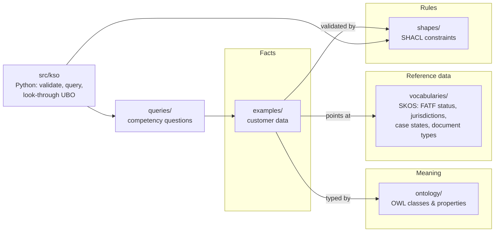

# KSO — KYC & Sanctions Ontology (First Line of Defence)

[](https://github.com/rschmick71/kyc-sanctions-ontology/actions/workflows/validate.yml)

A modular **OWL / SKOS / SHACL** knowledge model for First Line of Defence
KYC, beneficial ownership, sanctions screening and 1LOD → 2LOD escalation at
a cross-border trade bank, with Python tooling that validates it and answers
real compliance questions against it.

> **Independent portfolio project.** Not affiliated with, endorsed by, or
> derived from the internal materials of any financial institution. All
> example entities and people are fictional. Nothing here is legal or
> compliance advice.

---

## Why a graph?

KYC data is a network pretending to be a table. Ownership is a chain,
correspondent banking is nested, trade is a route, and policy (the 10% vs 25%
UBO threshold) depends on where each node sits. Relational schemas flatten
that into joins and hard-coded rules. This project keeps **meaning** (OWL),
**reference data** (SKOS), **rules** (SHACL) and **facts** (instance data)
in separate layers, so each can change on its own schedule.



## What it models

| Module | Covers |
|---|---|
| `core` | Parties, jurisdictions, **US Master Profile + Foreign Extension**, evidence documents, local document requirements |
| `ownership` | Reified ownership stakes, control prong, UBO determinations |
| `risk` | FATF status → UBO threshold and EDD trigger, risk assessments and factors |
| `screening` | Watch lists, screening events, alerts and dispositions |
| `governance` | Cases, **maker/checker escalation**, system lock, 2LOD disposition |
| `correspondent` | Respondent relationships, transitive nesting tiers, CBDDQ |
| `trade-finance` | Transactions, shipments, routes, vessels, HS codes, dual-use flags |

The operating model it encodes is in
[`docs/architecture/lines-of-defence-operating-model.md`](docs/architecture/lines-of-defence-operating-model.md).

## Quick start

```bash
python3 -m venv .venv && source .venv/bin/activate
pip install -e ".[dev]"

pytest                      # 27 tests: parsing, SHACL policy rules, ownership, queries
kso validate                # SHACL-validate the bundled example
kso ubo ex:Harbourline      # look-through UBO report
kso query cq03              # which Singapore documents are still missing?
```

```text
$ kso ubo ex:Harbourline
Threshold applied: 10%
   55.00%  Amara Njoroge
   25.00%  Omar Haddad
   12.00%  Daniel Otieno
```

Kenya's FATF status compresses the threshold from 25% to 10%, which pulls the
12% holder into scope. Omar Haddad's 25% is indirect (100% of a UAE holding
company that owns 25%), so it is computed by look-through, not stored.

## Policy rules enforced in SHACL

- Every legal entity is incorporated in exactly one known jurisdiction.
- Direct stakes in an entity cannot sum to more than 100%.
- Every jurisdiction resolves to exactly one UBO threshold via its FATF status.
- **US Master Anchor Mandate:** a foreign extension must extend a master profile *of the same party*.
- **Four-eyes:** an escalation's checker cannot be its maker.
- **System lock:** an escalated case must be locked.
- LEI, IMO and HS code formats.

## Repository layout

```text
.
├── ontology/
│   ├── kso.ttl                 # entry point — owl:imports every module
│   └── modules/                # one file per concern
├── vocabularies/               # SKOS reference data (changes often)
├── shapes/                     # SHACL rules (what valid data looks like)
├── examples/                   # fictional worked example
├── queries/                    # SPARQL competency questions
├── src/kso/                    # Python: load, validate, query, look-through UBO
├── tests/                      # pytest suite, run in CI
└── docs/
    ├── architecture/           # 1LOD / 2LOD / 3LOD operating model
    └── adr/                    # architecture decision records
```

## Design decisions

| ADR | Decision |
|---|---|
| [0001](docs/adr/0001-model-roles-and-relationships-not-types.md) | Model roles and relationships, not types (UBO is a determination, not a class) |
| [0002](docs/adr/0002-shacl-for-validation-owl-for-meaning.md) | SHACL for validation, OWL for meaning (closed vs open world) |
| [0003](docs/adr/0003-graph-for-facts-code-for-arithmetic.md) | Graph for facts and policy, code for arithmetic |
| [0004](docs/adr/0004-reference-data-as-skos-vocabularies.md) | Reference data as SKOS vocabularies, separate from the ontology |

## Roadmap

- [ ] Write `BeneficialOwnerDetermination` nodes back to the graph from `kso ubo`
- [ ] FIBO / LCC alignment module (`skos:closeMatch`)
- [ ] Correspondent-banking worked example with a nested tier
- [ ] PEP and adverse-media modelling
- [ ] Case-state transition rules (FSM) as SHACL
- [ ] Publish HTML documentation (pyLODE / Widoco) to GitHub Pages
- [ ] Agentic layer: LLM-assisted document intake constrained by SHACL

## Namespaces

| Prefix | IRI |
|---|---|
| `kso:` | `https://w3id.org/kso/ontology#` |
| `ksov:` | `https://w3id.org/kso/vocab#` |
| `ksoj:` | `https://w3id.org/kso/jurisdiction/` |
| `ksod:` | `https://w3id.org/kso/local-document/` |

w3id.org IRIs are persistent identifiers; the redirect is not yet registered.

## How this was built

I designed the model, the policy rules and the architecture decisions from my
experience in 1LOD KYC and Enhanced Due Diligence. The Python tooling and tests
were implemented with AI coding agents to my specification, then reviewed and
verified against the competency questions. I'm learning Python by working
through this codebase.

## License

[MIT](LICENSE)
