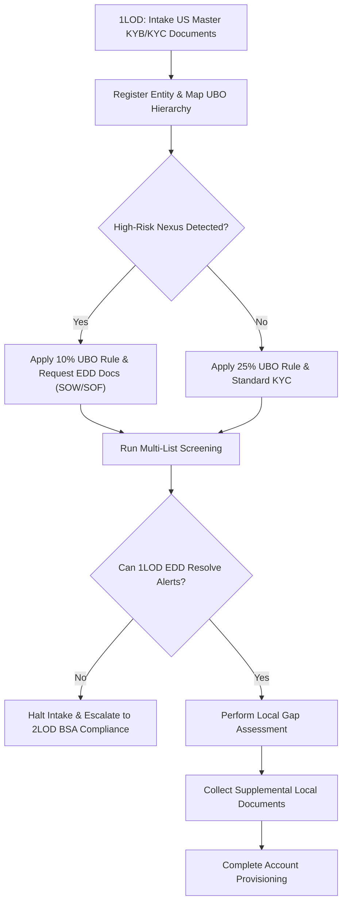
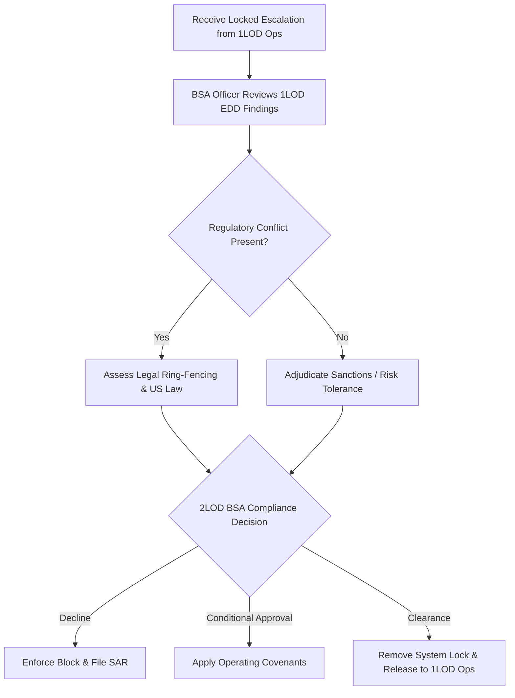
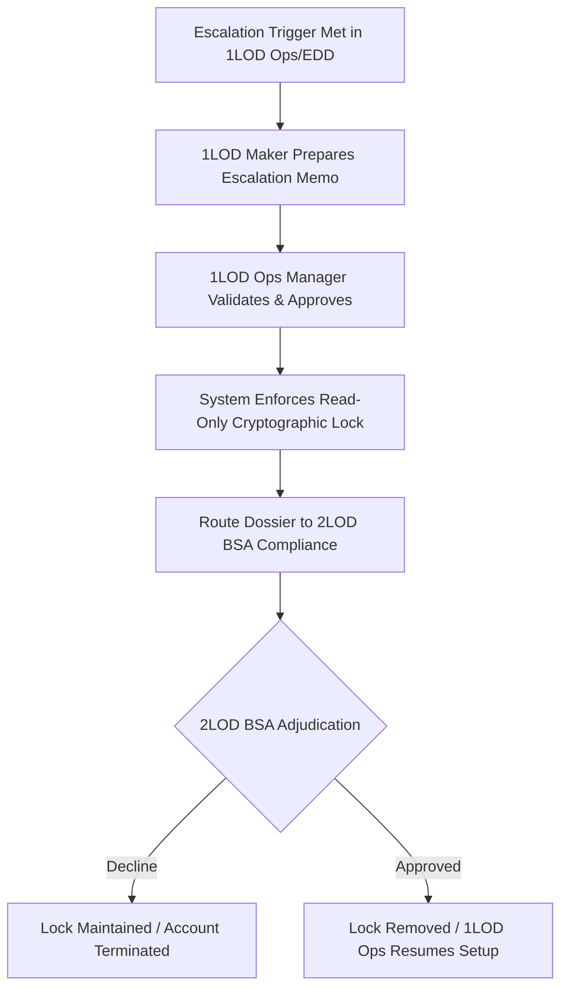

# Global 1LOD and 2LOD Architecture: US Master & Foreign Extension Model

## 1. First Line of Defence (1LOD): KYC, Sanctions, and EDD Operations

### 1LOD Documentation Mandates

1LOD Operations must collect and cryptographically ingest the following authoritative records to instantiate the US Master Profile before any semantic traversal or FSM rule gating occurs.

- **Standard KYB (Know Your Business - Entity Level):**
  - Articles of Incorporation / Certificate of Formation.
  - Certificate of Good Standing (issued within 12 months).
  - Corporate Resolution or Board Minutes designating authorized signatories.
  - IRS Form W-9 / EIN Verification Letter.
  - FinCEN CDD Appendix A (Beneficial Ownership Certification).
  - Complete Ownership and Control Organizational Chart.
- **Standard KYC (Know Your Customer - UBOs and Control Persons):**
  - Primary ID: Unexpired, Government-Issued Photo Identification (e.g., Passport, State ID).
  - Secondary ID: Proof of Residential Address (e.g., Utility bill, bank statement issued within the last 60 days).
- **Enhanced Due Diligence (EDD - Triggered by High-Risk/FATF Nexus):**
  - Independent Source of Wealth (SOW) corroboration (e.g., Audited Financial Statements, Corporate Tax Returns).
  - Source of Funds (SOF) transactional corroboration (e.g., origin of incoming wire capital).
  - Primary Customer and Supplier Lists (to evaluate supply chain geography).
  - *For Respondent FIs only:* Cryptographically signed Wolfsberg Correspondent Bank Due Diligence Questionnaire (CBDDQ) and copy of the respondent’s internal AML policy.

### 1LOD Policies

- **Operational Ownership:** 1LOD is the operational engine. It exclusively owns the execution of full KYB/KYC, Sanctions screening, and Enhanced Due Diligence (EDD) for all US Master Profiles and foreign extensions.
- **US Master Anchor Mandate:** 1LOD must establish a fully verified US Master Profile compliant with FinCEN CDD Rules and NYDFS Part 504 before processing any foreign operating account requests.
- **Dynamic UBO Traversal & EDD:** 1LOD must unwrap corporate hierarchies to ≥ 25% standard control. If a FATF Increased Monitoring nexus is identified, the system compresses the threshold to ≥ 10% and triggers the mandatory 1LOD EDD documentation workflows defined above.
- **Foreign Extension Execution:** For local accounts abroad, 1LOD utilizes the US Master Profile as the baseline and solely collects the supplemental local documents required by the foreign banking regulator.

### 1LOD Procedures

1. **Intake & Graph Instantiation:** 1LOD Operations ingest KYB and KYC commercial documents via secure API. The system parses the payload and maps the entity hierarchy.
2. **Screening & EDD:** Run automated screening against sanctions and PEP lists. If high-risk vectors are detected, 1LOD EDD analysts execute enhanced investigations, collect EDD documentation (SOW/SOF), and clear false positives using deterministic identifiers.
3. **Foreign Gap Assessment:** Cross-reference the verified US Master Profile against the target country's statutory requirements to generate a targeted Request for Information (RFI) for missing local records.
4. **Provisioning or Escalation:** If 1LOD EDD successfully mitigates all risks, the account is provisioned. If a true sanctions match is suspected or risk exceeds standard tolerances, 1LOD triggers the Kill Switch to escalate to 2LOD BSA Compliance.

### 1LOD Process Flow

## 2. Second Line of Defence (2LOD): BSA Compliance & Control Assurance

### 2LOD Structural Demarcation

The 2LOD framework is bifurcated into two distinct operational mandates:

1. **BSA Compliance (The Escalation Endpoint):** Acts as the ultimate policy authority and decision-maker for complex escalations routed from 1LOD Operations.
2. **Control Assurance (ORM, Internal Audit, External Audit):** Operates parallel to the escalation pathway, systematically testing 1LOD controls, validating the FSM rule gates, and auditing overall compliance with the US Master pipeline.

### 2LOD BSA Compliance Policies

- **Independent Veto Authority:** 2LOD BSA Compliance maintains unchallengeable veto authority over escalations, insulated from commercial pressure.
- **Sanctions Adjudication:** Exclusively adjudicates escalated true matches and manages regulatory disclosures, asset freezes, and Suspicious Activity Report (SAR) filings.
- **Cross-Border Regulatory Conflict:** Adjudicates operational conflicts between US extraterritorial transparency rules and local foreign statutory restrictions.

### 2LOD BSA Compliance Procedures

1. **Escalation Intake:** Receive locked escalation packages from 1LOD Operations.
2. **Policy & Legal Review:** Evaluate the 1LOD EDD findings and corroborating documents against enterprise risk appetite and legal mandates.
3. **Adjudication & Final Disposition:** Issue a binding decision:
   - *Decline:* Terminate onboarding, enforce a block, and execute SAR filings.
   - *Conditional Approval:* Approve subject to mandatory compliance covenants (e.g., barring nested correspondent services).
   - *Clearance:* Overturn the block and return the file to 1LOD Operations for setup.

### 2LOD BSA Compliance Adjudication Flow

## 3. Third Line of Defence (3LOD): Regulatory Bodies

### 3LOD Policies

- **Statutory Governance:** 3LOD consists of the external regulatory authorities (e.g., OCC, FED, NYDFS, FinCEN, and foreign Central Banks) that establish the legal frameworks the 1LOD and 2LOD systems are built to enforce.
- **Examination & Enforcement:** 3LOD conducts routine and targeted examinations of the bank's operational model, possessing the authority to issue consent orders, levy fines, or mandate systemic remediations if 1LOD execution or 2LOD oversight fails.

## 4. 1LOD to 2LOD BSA Compliance Escalation Protocol

### Escalation Policies

- **Mandatory Escalation Triggers:** 1LOD Operations must route a file to 2LOD BSA Compliance when encountering: (1) suspected true sanctions matches, (2) unmitigated high-risk scores post-EDD, or (3) irreconcilable cross-border regulatory conflicts.
- **Dual-Control Handoff & Systemic Lock:** Escalations require a Maker (1LOD EDD Analyst) and a Checker (1LOD Ops Manager). Approval applies a read-only cryptographic lock to the file, stripping 1LOD of provisioning capabilities until 2LOD BSA Compliance acts.

### Escalation Procedures

1. **Dossier Compilation (Maker):** The 1LOD EDD Analyst compiles the screening records, EDD documents, ownership structure map, and the local gap assessment into an Escalation Memo.
2. **Supervisor Validation (Checker):** The 1LOD Ops Manager reviews the memo and updates the case state to `2LOD_BSA_Review_Pending`.
3. **System Lock:** The platform locks the profile across all jurisdictions and routes the payload to 2LOD BSA Compliance.
4. **Disposition Processing:** 2LOD BSA Compliance records a decision. The platform either maintains the lock (Decline) or lifts the lock (Approve), allowing 1LOD Ops to conclude the workflow.

### Escalation Process Flow

## 5. 20-Jurisdiction Regulatory & Local Requirements Matrix

This matrix details the supplemental local requirements needed by 1LOD Operations to execute the Jurisdictional Extension, utilizing the US Master Profile as the foundational anchor.

> FATF statuses reflect the list of jurisdictions under increased monitoring as of the 19 June 2026 FATF plenary. Risk tiers and UBO thresholds are illustrative firm risk-appetite settings, not regulatory requirements.

| Country          | Primary Regulator                                            | FATF Status          | Risk Tier | UBO Rule | Supplemental Local Requirements (Beyond US Baseline)         |
| ---------------- | ------------------------------------------------------------ | -------------------- | --------- | -------- | ------------------------------------------------------------ |
| **USA (Master)** | [OCC](https://www.occ.treas.gov) / [FinCEN](https://www.fincen.gov) | Standard             | Low-Med   | 25%     | FinCEN CDD Form, State Registry Certificate, Form W-9.       |
| **UK**           | [FCA](https://www.fca.org.uk) / HMT                          | Standard             | Low       | 25%     | Companies House Extract, PSC (Persons with Significant Control) Register. |
| **Singapore**    | [MAS](https://www.mas.gov.sg)                                | Standard             | Low       | 25%     | ACRA BizFile Extract, Local Resident Director Verification.  |
| **Kenya**        | [CBK](https://www.centralbank.go.ke)                         | Increased Monitoring | High      | 10%     | Kenya Revenue Authority (KRA) PIN, Form CR12 (Directors Registry). |
| **Vietnam**      | [SBV](https://www.sbv.gov.vn) | Increased Monitoring | High      | 10%     | SBV Foreign Exchange Approval, Investment Registration Certificate (IRC). |
| **UAE**          | [CBUAE](https://www.centralbank.ae)                          | Standard             | Med       | 25%     | DED Commercial License, Emirates ID for Local Signatories.   |
| **Switzerland**  | [FINMA](https://www.finma.ch)                                | Standard             | Low       | 25%     | Form A (Declaration of Beneficial Owner), Zefix Registry Extract. |
| **Hong Kong**    | [HKMA](https://www.hkma.gov.hk)                              | Standard             | Low       | 25%     | Business Registration Certificate (BRC), TCSP Certification (if used). |
| **Germany**      | [BaFin](https://www.bafin.de)                                | Standard             | Low       | 25%     | Transparenzregister Extract, Commercial Register Extract (Handelsregister). |
| **Brazil**       | [BACEN](https://www.bcb.gov.br)                              | Standard             | Med       | 25%     | National Tax ID (CNPJ), BACEN Direct Foreign Investment Registration. |
| **South Africa** | [SARB](https://www.resbank.co.za)                            | Standard             | Med       | 25%     | CIPC Registration Certificate, SARB Exchange Control Approval. |
| **Australia**    | [AUSTRAC](https://www.austrac.gov.au)                        | Standard             | Low       | 25%     | ASIC Current Company Extract, Director Identity Verification. |
| **India**        | [RBI](https://www.rbi.org.in) | Standard             | Med       | 25%     | Corporate PAN Card, FEMA Regulatory Compliance Attestation.  |
| **Japan**        | [JFSA](https://www.fsa.go.jp)                                | Standard             | Low       | 25%     | Corporate Number (Hojin Bangou), Registry Certificate (Tokibo Tohon). |
| **Mexico**       | [CNBV](https://www.gob.mx/cnbv)                              | Standard             | Med-High  | 25%     | Federal Tax Registry (RFC), Valid Electronic Signature (Fiel). |
| **Angola**       | [BNA](https://www.bna.ao)                                    | Increased Monitoring | High      | 10%     | BNA Capital Importation License, Revenue Collection Receipt (DAR). |
| **Canada**       | [FINTRAC](https://fintrac-canafe.gc.ca)                      | Standard             | Low       | 25%     | Provincial Corporate Registry Profile, Corporate Articles of Amendment. |
| **France**       | [ACPR](https://acpr.banque-france.fr)                        | Standard             | Low       | 25%     | Kbis Extract (issued within 90 days), RBE Beneficial Ownership Filing. |
| **Bolivia**      | [ASFI](https://www.asfi.gob.bo)                              | Increased Monitoring | High      | 10%     | Tax ID (NIT), Commercial Registry Certificate (Fundempresa/SEPREC). |
| **Iraq**         | [CBI](https://cbi.iq)                                        | Increased Monitoring | High      | 10%     | Central Bank AML Approval, Ministry of Trade Corporate Registration. |