# 📑 KSO Ontology Reference
**The complete specification of the KYC & Sanctions Ontology (First Line of Defence): every module, class, property, rule, vocabulary and competency question, with diagrams, code and captured runs**

> **Scope of this document.** [`repository-guide.md`](repository-guide.md) is the *walkthrough*: what each folder is and how to read Turtle for the first time. This file is the *reference*: it documents the ontology **term by term**, shows what the tooling actually outputs, maps every construct back to the operating model, and records what is still missing. Read the guide first if RDF is new to you.
>
> **Version documented:** `owl:versionInfo "0.1.0"` · all tables below are **generated from the Turtle files**, and all screenshots are **captured from real runs** of the repository at this version.

---

## 📖 How to Read This Reference

Every header carries a tag from the **Master Technical Emoji Index**, so you can see which layer of the system a section belongs to before you read it.

| Emoji | Index category | What it marks in this document |
|:---:|---|---|
| 🧩 | Taxonomies & Classifications | Scope, module boundaries, SKOS vocabularies |
| 📜 | Ontology Schemas / Syntax | Turtle files, namespaces, the entry point |
| ⚓ | Symbolic Nodes / Entities | OWL classes and the individuals in the worked example |
| 🕸️ | Knowledge Graphs / Edges | Object properties and reified relationships |
| 📐 | Formal Logic & Axioms | OWL characteristics, SHACL shapes, ADRs |
| 🔤 | Syntax & Serialization | SPARQL competency questions |
| 🌉 | Symbolic–Neural Translators | Python code that bridges the graph and the arithmetic it can't do |
| 🧭 | Agent State Nodes / DAGs | Case states, escalation flow, operating-model traceability |
| 🛡️ | Constraint-Driven Guardrails | Policy rules that must never be violated (four-eyes, lock, anchor mandate) |
| 📊 | Empirical Benchmarks | Tests, CI and captured outputs |
| 💻 | Local Runner Setups | Running it on your machine |
| ⚠️ | Edge Cases & Failure Modes | Verified defects, gaps against the project brief, limitations |
| 🔭 | Future Horizons | Proposed extensions (clearly marked **PROPOSED**, not in the repo) |

> **Statistical-layer emojis (🧬 ⚡ 🎛️ ⚖️ 🛑) appear only in 🔭 Future Horizons.** KSO v0.1.0 is purely symbolic: no embeddings, weights or model calls. Tagging today's files with them would misstate what exists.

### Notation used in the tables

| Notation | Meaning |
|---|---|
| `kso:Party` | A compact IRI (CURIE). Expand the prefix using the namespace table in §3 |
| `A` → `B` | Property domain → range: the subject is expected to be an `A`, the object a `B` |
| **Functional** | `owl:FunctionalProperty`: at most one value per subject |
| **Transitive** | `owl:TransitiveProperty`: if *a→b* and *b→c* then *a→c* |
| — | Not declared |

### At a glance

| Measure | Count | Source |
|---|---:|---|
| Ontology modules (+ 1 entry point) | 7 | `ontology/modules/*.ttl` |
| OWL classes | 25 | all modules |
| Object properties | 51 | all modules |
| Datatype properties | 24 | all modules |
| SKOS concept schemes | 13 | `vocabularies/` |
| SKOS concepts (incl. 20 jurisdictions, 41 local document types) | 110 | `vocabularies/` |
| SHACL node shapes (3 with SHACL-SPARQL constraints) | 11 | `shapes/kso-shapes.ttl` |
| Triples: schema + vocabularies / example / combined | 962 / 109 / 1,071 | measured with `rdflib` |
| SPARQL competency questions | 5 | `queries/` |
| Automated tests (all passing) | 27 | `tests/` |

---

## 🧩 1. The Problem the Ontology Solves

A global trade bank's First Line of Defence has to answer questions like these every day, across many jurisdictions at once:

- *Who ultimately owns this company, and which of them must we identify and verify?* The answer depends on **where** the company sits, because a FATF grey-listing drops the threshold from 25% to 10%.
- *What does Singapore's regulator need from us that the US master file doesn't already cover?*
- *Which files are frozen waiting for Compliance, and who signed off the escalation?*
- *Does this letter of credit move goods through a high-risk port?*

Each of these is a **path through a network**: ownership is a chain, correspondent banking is nested, a shipment is a route, and policy depends on which node you're standing on. A relational schema flattens that into joins plus rules hard-coded in application code. KSO keeps the network as a network, and keeps **meaning, reference data, rules and facts in separate layers** so each can change on its own schedule.

### 🧩 1.1 The three lines of defence, as modelled

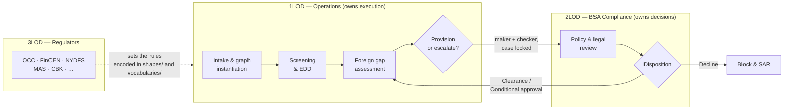

| Line | Ontology footprint |
|---|---|
| **1LOD Operations** | `core` (profiles, documents), `ownership`, `risk`, `screening`, `trade-finance`, `correspondent` |
| **2LOD BSA Compliance** | `governance` (`Escalation`, `Disposition`), `ksov:SecondLine` |
| **3LOD Regulators** | `kso:primaryRegulator`, `kso:requiresDocument`, FATF status in `vocabularies/` |

The full operating model lives in [`architecture/lines-of-defence-operating-model.md`](architecture/lines-of-defence-operating-model.md). §13 of this reference traces each of its steps to the ontology.

---

## 🧩 2. Architecture

### 🧩 2.1 Four layers that change at different speeds

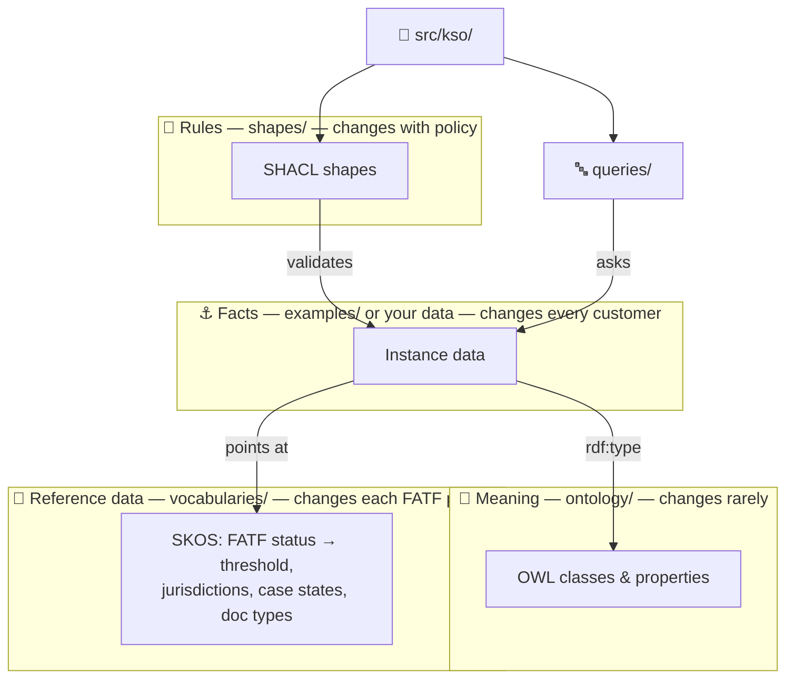

**Why this matters (systems-design view).** The layers have different **owners** and **change cadences**. The ontology is owned by the architect and changes only through ADRs. The vocabularies are owned by compliance reference-data teams and change three times a year. Shapes are owned by policy and change when a rule changes. Facts change constantly. If you mix them in one file, every FATF plenary looks like a schema migration in `git diff`. Kept apart, a grey-list change is a one-line diff that a reviewer can approve in seconds.

### 🧩 2.2 Module dependency: a star around `core`

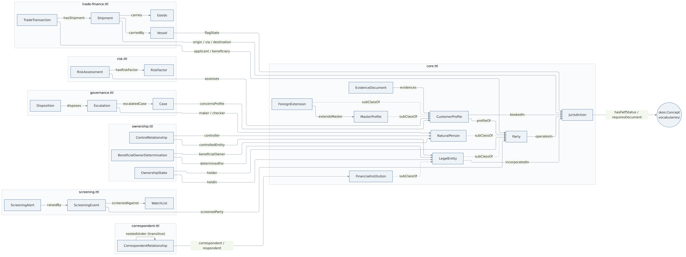

*Figure 1. Every class and object property in the ontology, grouped by module. Rendered with Mermaid (ELK layout) from the Turtle definitions. Dotted edges are `rdfs:subClassOf`.*

The figure shows the one structural rule of the module system: **every module points into `core`, and no module points into another non-core module.** `core` imports nothing. This is deliberate:

- You can add `pep.ttl` or `product.ttl` without touching the other six.
- Any module can be reviewed, versioned or dropped on its own.
- There are no import cycles, so tools like Protégé and pyLODE load it predictably.

| Module | Triples | Classes | Object props | Datatype props | The question it answers |
|---|---:|---:|---:|---:|---|
| `core` | 108 | 9 | 10 | 6 | *Who* is involved, *where*, and what profile does the bank hold? |
| `ownership` | 59 | 3 | 7 | 3 | *Who owns or controls whom*, and by how much? |
| `risk` | 57 | 2 | 7 | 4 | *How risky* is it, and does it trigger EDD? |
| `screening` | 46 | 3 | 5 | 3 | *Which lists* was a party checked against, and what hit? |
| `governance` | 66 | 3 | 9 | 3 | *Who decided what*, and what state is the case in? |
| `correspondent` | 30 | 1 | 3 | 2 | *Which banks* reach us through which other banks? |
| `trade-finance` | 67 | 4 | 10 | 3 | *What goods* move *where*, on *which vessel*? |
| **Total** | **433** | **25** | **51** | **24** | |

---

## 📜 3. Namespaces, IRIs and the Entry Point

### 📜 3.1 Namespaces

| Prefix | Namespace IRI | Holds |
|---|---|---|
| `kso:` | `https://w3id.org/kso/ontology#` | Classes and properties |
| `ksov:` | `https://w3id.org/kso/vocab#` | Controlled values (SKOS) |
| `ksoj:` | `https://w3id.org/kso/jurisdiction/` | The 20 jurisdictions |
| `ksod:` | `https://w3id.org/kso/local-document/` | Jurisdiction-specific document types |
| `ksos:` | `https://w3id.org/kso/shapes#` | SHACL shapes |
| `ex:` | `https://w3id.org/kso/example/` | Fictional worked-example individuals |

**IRI conventions**

- Classes are `UpperCamelCase` nouns (`kso:OwnershipStake`). Properties are `lowerCamelCase`, read left to right as a sentence: *stake* `heldIn` *entity*, *profile* `extendsMaster` *profile*.
- The ontology uses a **hash** namespace (`…/ontology#Party`): it is one document, so terms are fragments. Data uses **slash** namespaces (`…/jurisdiction/KE`): each individual can be served as its own resource.
- `w3id.org` is a persistent-identifier service. The IRIs are stable names today, but they won't resolve in a browser until the redirect is registered (see ⚠️ §14).

### 📜 3.2 The entry point — `ontology/kso.ttl`

Loading this one file pulls in every module through `owl:imports`:

```turtle
<https://w3id.org/kso/ontology>
    a owl:Ontology ;
    dcterms:title "KSO — KYC & Sanctions Ontology"@en ;
    dcterms:creator "Ron Schmick" ;
    dcterms:license <https://opensource.org/licenses/MIT> ;
    vann:preferredNamespacePrefix "kso" ;
    owl:versionInfo "0.1.0" ;
    owl:imports
        <https://w3id.org/kso/ontology/core> ,
        <https://w3id.org/kso/ontology/ownership> ,
        <https://w3id.org/kso/ontology/risk> ,
        <https://w3id.org/kso/ontology/screening> ,
        <https://w3id.org/kso/ontology/governance> ,
        <https://w3id.org/kso/ontology/correspondent> ,
        <https://w3id.org/kso/ontology/trade-finance> .
```

> **How the Python tooling loads it.** `owl:imports` points at `w3id.org` IRIs that don't resolve yet, so `kso.graph` doesn't follow imports. It globs every `.ttl` file under `ontology/` and `vocabularies/` and parses them into one `rdflib.Graph`. The effect is the same, and it works offline. Protégé users should open the module files directly, or add a catalog file mapping each IRI to its local path.

---

## ⚓ 4. Module Reference

Each module below has the same six parts: **purpose**, **diagram**, **classes**, **properties**, **key Turtle**, and **design notes**. Each ends with a line listing the shapes (§6) and competency questions (§9) that use it.

> Note on definitions: 61 of the 75 properties carry only an `rdfs:label`, no `skos:definition`. Their rows show "—" in the definition column. That's a documentation gap, recorded in ⚠️ §14.

---

### ⚓ 4.1 `core` — parties, jurisdictions, profiles, evidence

**Purpose.** The vocabulary every other module leans on: *who* (parties), *where* (jurisdictions), *which KYC record* (profiles) and *on what evidence* (documents). It imports nothing.

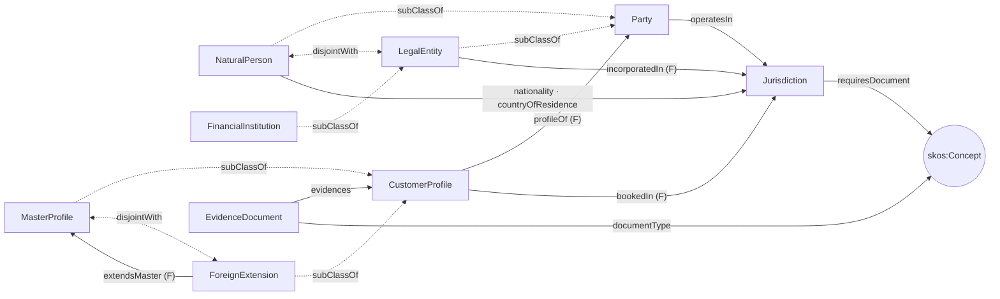

| Class | Sub-class of | Disjoint with | Definition |
|---|---|---|---|
| `kso:CustomerProfile` | — | — | The bank's KYC record of a party in one booking jurisdiction. |
| `kso:EvidenceDocument` | — | — | A document collected by 1LOD Operations as evidence for a customer profile. |
| `kso:FinancialInstitution` | `kso:LegalEntity` | — | A legal entity licensed to conduct banking or payment business. |
| `kso:ForeignExtension` | `kso:CustomerProfile` | — | A local account profile abroad that reuses the master profile and adds only the supplemental documents the local regulator requires. |
| `kso:Jurisdiction` | — | — | A territory with its own legal and regulatory regime. Instances live in vocabularies/jurisdictions.ttl. |
| `kso:LegalEntity` | `kso:Party` | — | An organisation with separate legal personality (company, partnership, trust, foundation). |
| `kso:MasterProfile` | `kso:CustomerProfile` | `kso:ForeignExtension` | The anchor KYC profile, fully verified under the home regulator (e.g. FinCEN CDD Rule, NYDFS Part 504). Must exist before any foreign extension. |
| `kso:NaturalPerson` | `kso:Party` | `kso:LegalEntity` | A human being. The only kind of party that can be an ultimate beneficial owner. |
| `kso:Party` | — | — | A natural person or organisation capable of holding rights, obligations, or ownership. |

| Property | Kind | Domain → Range | Characteristics | Definition |
|---|---|---|---|---|
| `kso:bookedIn` | object | `kso:CustomerProfile` → `kso:Jurisdiction` | Functional | — |
| `kso:countryOfResidence` | object | `kso:NaturalPerson` → `kso:Jurisdiction` | — | — |
| `kso:documentType` | object | `kso:EvidenceDocument` → `skos:Concept` | — | — |
| `kso:evidences` | object | `kso:EvidenceDocument` → `kso:CustomerProfile` | — | — |
| `kso:extendsMaster` | object | `kso:ForeignExtension` → `kso:MasterProfile` | Functional | — |
| `kso:incorporatedIn` | object | `kso:LegalEntity` → `kso:Jurisdiction` | Functional | — |
| `kso:nationality` | object | `kso:NaturalPerson` → `kso:Jurisdiction` | — | — |
| `kso:operatesIn` | object | `kso:Party` → `kso:Jurisdiction` | — | — |
| `kso:profileOf` | object | `kso:CustomerProfile` → `kso:Party` | Functional | — |
| `kso:requiresDocument` | object | `kso:Jurisdiction` → `skos:Concept` | — | A supplemental document type the jurisdiction's regulator requires beyond the master-profile baseline. |
| `kso:isoCountryCode` | datatype | `kso:Jurisdiction` → `xsd:string` | — | — |
| `kso:issuedOn` | datatype | `kso:EvidenceDocument` → `xsd:date` | — | — |
| `kso:legalName` | datatype | `kso:Party` → `xsd:string` | — | — |
| `kso:leiCode` | datatype | `kso:LegalEntity` → `xsd:string` | — | ISO 17442 Legal Entity Identifier — a deterministic identifier used to clear screening false positives. |
| `kso:primaryRegulator` | datatype | `kso:Jurisdiction` → `xsd:string` | — | — |
| `kso:registrationNumber` | datatype | `kso:LegalEntity` → `xsd:string` | — | Identifier issued by the company registry of the incorporation jurisdiction. |

**Key Turtle: the US Master + Foreign Extension model**

```turtle
kso:MasterProfile
    a owl:Class ;
    rdfs:subClassOf kso:CustomerProfile ;
    owl:disjointWith kso:ForeignExtension ;
    skos:definition "The anchor KYC profile, fully verified under the home regulator
                     (e.g. FinCEN CDD Rule, NYDFS Part 504). Must exist before any foreign extension."@en .

kso:extendsMaster
    a owl:ObjectProperty , owl:FunctionalProperty ;
    rdfs:domain kso:ForeignExtension ;
    rdfs:range  kso:MasterProfile .
```

**Design notes**

- **"Customer" is not a kind of party.** A party *is* a person or a company; being a customer is a *relationship with the bank*, recorded as a `CustomerProfile` that points at the party (`profileOf`). The same company can have a US master profile and a Singapore extension, which is two profiles and one party ([ADR-0001](adr/0001-model-roles-and-relationships-not-types.md)).
- **The disjointness axioms are meaningful.** `NaturalPerson ⊓ LegalEntity = ∅` is what lets the UBO walk (§10) stop at humans and recurse through companies. `MasterProfile ⊓ ForeignExtension = ∅` stops one record from playing both roles.
- **`kso:requiresDocument` hangs off the jurisdiction, not the profile.** Regulators set requirements per country, so the requirement is stated once, per country, and every extension booked there inherits it. That is what makes CQ3's gap assessment automatic.

*Used by:* `PartyShape`, `LegalEntityShape`, `JurisdictionShape`, `CustomerProfileShape`, `ForeignExtensionShape` · CQ1, CQ2, CQ3.

---

### 🕸️ 4.2 `ownership` — stakes, control and beneficial-ownership determinations

**Purpose.** Captures *how much* of an entity each party holds (the ownership prong), *who runs it* regardless of shares (the control prong, as in FinCEN's CDD Rule), and the *recorded outcome* of a UBO analysis.

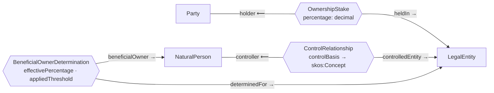

| Class | Sub-class of | Disjoint with | Definition |
|---|---|---|---|
| `kso:BeneficialOwnerDetermination` | — | — | A recorded finding that a natural person is a beneficial owner of an entity at a given threshold. |
| `kso:ControlRelationship` | — | — | Significant managerial control over a legal entity, independent of equity (e.g. CEO, managing director). |
| `kso:OwnershipStake` | — | — | A direct equity interest one party holds in a legal entity. *Reified as a class because a plain 'owns' triple cannot carry a percentage.* |

| Property | Kind | Domain → Range | Characteristics | Definition |
|---|---|---|---|---|
| `kso:beneficialOwner` | object | `kso:BeneficialOwnerDetermination` → `kso:NaturalPerson` | — | — |
| `kso:controlBasis` | object | `kso:ControlRelationship` → `skos:Concept` | — | — |
| `kso:controlledEntity` | object | `kso:ControlRelationship` → `kso:LegalEntity` | — | — |
| `kso:controller` | object | `kso:ControlRelationship` → `kso:NaturalPerson` | — | — |
| `kso:determinedFor` | object | `kso:BeneficialOwnerDetermination` → `kso:LegalEntity` | — | — |
| `kso:heldIn` | object | `kso:OwnershipStake` → `kso:LegalEntity` | Functional | — |
| `kso:holder` | object | `kso:OwnershipStake` → `kso:Party` | Functional | — |
| `kso:appliedThreshold` | datatype | `kso:BeneficialOwnerDetermination` → `xsd:decimal` | — | — |
| `kso:effectivePercentage` | datatype | `kso:BeneficialOwnerDetermination` → `xsd:decimal` | — | Product of stake percentages along every ownership chain, summed across chains. |
| `kso:percentage` | datatype | `kso:OwnershipStake` → `xsd:decimal` | Functional | Direct equity percentage, 0 < p <= 100. |

**Why reify? (the single most important pattern in KSO)**

A triple has exactly three slots, so there's nowhere to put "55%":

```turtle
ex:AmaraNjoroge  kso:owns  ex:Harbourline .      # ✗ how much? since when? per which register?
```

Turning the relationship into a node gives the facts somewhere to live:

```turtle
ex:Stake-Njoroge a kso:OwnershipStake ;
    kso:holder     ex:AmaraNjoroge ;
    kso:heldIn     ex:Harbourline ;
    kso:percentage 55.0 .
```

The stake node can later carry `effectiveFrom`, `source` (e.g. the Kenyan CR12 register) or a voting-vs-economic split, all without changing any other class. This follows the same reified-shareholding pattern as the EDM Council's FIBO, which keeps a future alignment cheap.

**Why `BeneficialOwnerDetermination` and not a `UBO` class.** Nobody is a UBO in general. A person is a UBO *of this entity, at this threshold, on this date*. Daniel Otieno's 12% makes him a UBO under Kenya's 10% rule and not under a 25% rule, and his shares didn't change. Recording the determination as its own node (with `appliedThreshold`) makes every finding **auditable**: an examiner can see which rule produced which list.

> **Status:** the determination class and properties exist, but nothing writes determinations yet. `kso ubo` computes owners and prints them. Write-back is the first roadmap item.

*Used by:* `OwnershipStakeShape`, `LegalEntityShape` (stakes ≤ 100%) · CQ1 · `kso.ownership`.

---

### 📐 4.3 `risk` — FATF status, thresholds, assessments, EDD

**Purpose.** Connects jurisdictions to FATF status, and FATF status to the two policy levers that matter to 1LOD: the **UBO threshold** and the **EDD trigger**. Also records dated, reproducible customer risk assessments.

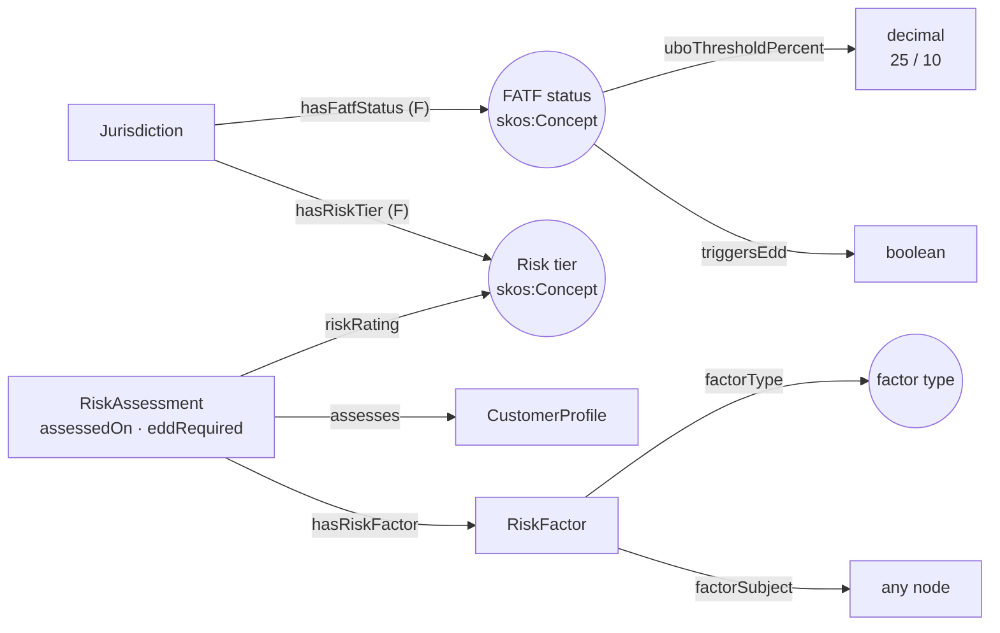

| Class | Sub-class of | Disjoint with | Definition |
|---|---|---|---|
| `kso:RiskAssessment` | — | — | A dated, reproducible customer risk rating with the factors that produced it. |
| `kso:RiskFactor` | — | — | One observed reason contributing to a risk rating (e.g. FATF nexus, PEP link, dual-use goods). |

| Property | Kind | Domain → Range | Characteristics | Definition |
|---|---|---|---|---|
| `kso:assesses` | object | `kso:RiskAssessment` → `kso:CustomerProfile` | — | — |
| `kso:factorSubject` | object | `kso:RiskFactor` → — | — | The node that gave rise to the factor (a jurisdiction, a person, a shipment). |
| `kso:factorType` | object | `kso:RiskFactor` → `skos:Concept` | — | — |
| `kso:hasFatfStatus` | object | `kso:Jurisdiction` → `skos:Concept` | Functional | — |
| `kso:hasRiskFactor` | object | `kso:RiskAssessment` → `kso:RiskFactor` | — | — |
| `kso:hasRiskTier` | object | `kso:Jurisdiction` → `skos:Concept` | Functional | — |
| `kso:riskRating` | object | `kso:RiskAssessment` → `skos:Concept` | — | — |
| `kso:assessedOn` | datatype | `kso:RiskAssessment` → `xsd:date` | — | — |
| `kso:eddRequired` | datatype | `kso:RiskAssessment` → `xsd:boolean` | — | — |
| `kso:triggersEdd` | datatype | `skos:Concept` → `xsd:boolean` | — | — |
| `kso:uboThresholdPercent` | datatype | `skos:Concept` → `xsd:decimal` | — | Beneficial-ownership percentage at or above which a natural person must be identified and verified. |

**Key idea: one fact, one place.** The threshold is attached **once to the FATF-status concept**, not copied onto each of the 20 countries:

```turtle
ksov:FatfIncreasedMonitoring a skos:Concept ;
    skos:prefLabel "Increased Monitoring"@en ;
    kso:uboThresholdPercent "10"^^xsd:decimal ;
    kso:triggersEdd true .

ksoj:KE kso:hasFatfStatus ksov:FatfIncreasedMonitoring .   # Kenya → 10%, EDD on
```

Resolving a threshold is a **two-hop path**: `?entity kso:incorporatedIn/kso:hasFatfStatus/kso:uboThresholdPercent ?t`. If FATF removes Kenya from the grey list, one triple changes and every query, shape and calculation follows.

**Design notes**

- `uboThresholdPercent` and `triggersEdd` have domain `skos:Concept`. Under RDFS inference this is harmless (the FATF statuses already *are* concepts), but it means the properties aren't restricted to FATF statuses. A tighter model would declare a `kso:FatfStatus` subclass of `skos:Concept` as the domain.
- `factorSubject` has no range on purpose. A risk factor can arise from a jurisdiction, a person or a shipment.

*Used by:* `JurisdictionShape` · CQ1, CQ2, CQ5 · `kso.ownership.ubo_threshold`.

---

### ⚓ 4.4 `screening` — watch lists, events and alerts

**Purpose.** Records *that* a party was screened, *against what*, *when*, and what came of it. It is an **event model**, not a screening engine: matching happens elsewhere, and its evidence lands here.

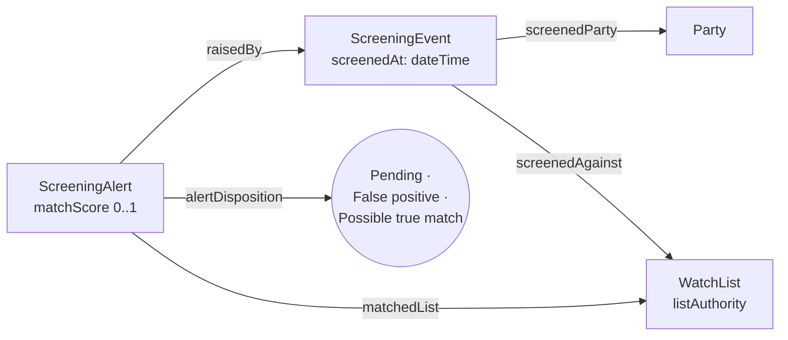

| Class | Sub-class of | Disjoint with | Definition |
|---|---|---|---|
| `kso:ScreeningAlert` | — | — | A potential match produced by a screening event, awaiting or holding a disposition. |
| `kso:ScreeningEvent` | — | — | One run of a party's details against one or more watch lists. |
| `kso:WatchList` | — | — | A published sanctions, PEP or adverse-media list a party can be screened against. |

| Property | Kind | Domain → Range | Characteristics | Definition |
|---|---|---|---|---|
| `kso:alertDisposition` | object | `kso:ScreeningAlert` → `skos:Concept` | — | — |
| `kso:matchedList` | object | `kso:ScreeningAlert` → `kso:WatchList` | — | — |
| `kso:raisedBy` | object | `kso:ScreeningAlert` → `kso:ScreeningEvent` | — | — |
| `kso:screenedAgainst` | object | `kso:ScreeningEvent` → `kso:WatchList` | — | — |
| `kso:screenedParty` | object | `kso:ScreeningEvent` → `kso:Party` | — | — |
| `kso:listAuthority` | datatype | `kso:WatchList` → `xsd:string` | — | — |
| `kso:matchScore` | datatype | `kso:ScreeningAlert` → `xsd:decimal` | — | Fuzzy-match similarity between 0 and 1. |
| `kso:screenedAt` | datatype | `kso:ScreeningEvent` → `xsd:dateTime` | — | — |

**Design notes**

- Event → alert → disposition mirrors how screening systems work: one run can raise zero or many alerts, and each alert gets its own disposition.
- `kso:leiCode` in `core` is documented as a **deterministic identifier used to clear false positives**. That is the operating model's "clear false positives using deterministic identifiers" step, expressed as data.
- **Gap:** nothing yet says *when* screening must happen (for example, "every determined beneficial owner must have a screening event"). In the worked example only Omar Haddad has been screened. See ⚠️ §14 and the tested rule in 🔭 §15.

*Used by:* `ScreeningAlertShape` · (no CQ yet).

---

### 🧭 4.5 `governance` — cases, escalation, dual control, disposition

**Purpose.** Encodes §4 of the operating model, the **1LOD → 2LOD escalation protocol**: a case, a locked escalation made by one person and checked by another, and a binding 2LOD decision.

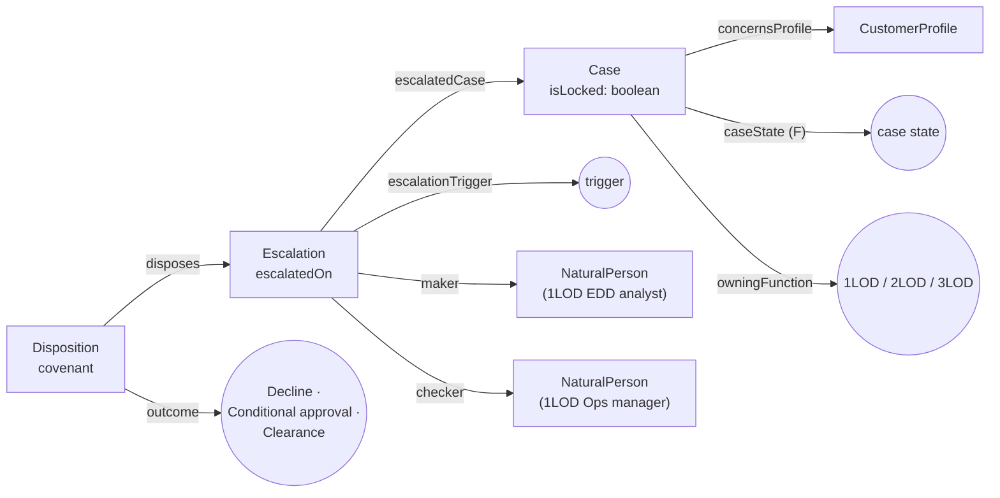

| Class | Sub-class of | Disjoint with | Definition |
|---|---|---|---|
| `kso:Case` | — | — | A unit of 1LOD work on one customer profile, moving through defined states. |
| `kso:Disposition` | — | — | The binding 2LOD BSA Compliance decision on an escalation. |
| `kso:Escalation` | — | — | A locked hand-off of a case from 1LOD Operations to 2LOD BSA Compliance. |

| Property | Kind | Domain → Range | Characteristics | Definition |
|---|---|---|---|---|
| `kso:caseState` | object | `kso:Case` → `skos:Concept` | Functional | — |
| `kso:checker` | object | `kso:Escalation` → `kso:NaturalPerson` | — | The 1LOD Ops manager who validated it. Must differ from the maker (enforced in SHACL). |
| `kso:concernsProfile` | object | `kso:Case` → `kso:CustomerProfile` | — | — |
| `kso:disposes` | object | `kso:Disposition` → `kso:Escalation` | — | — |
| `kso:escalatedCase` | object | `kso:Escalation` → `kso:Case` | — | — |
| `kso:escalationTrigger` | object | `kso:Escalation` → `skos:Concept` | — | — |
| `kso:maker` | object | `kso:Escalation` → `kso:NaturalPerson` | — | The 1LOD EDD analyst who compiled the escalation memo. |
| `kso:outcome` | object | `kso:Disposition` → `skos:Concept` | — | — |
| `kso:owningFunction` | object | — → `skos:Concept` | — | The line of defence accountable for a case, escalation or disposition. |
| `kso:covenant` | datatype | `kso:Disposition` → `xsd:string` | — | An operating condition attached to a conditional approval. |
| `kso:escalatedOn` | datatype | `kso:Escalation` → `xsd:dateTime` | — | — |
| `kso:isLocked` | datatype | `kso:Case` → `xsd:boolean` | — | True once a checker approves an escalation: 1LOD loses provisioning rights until 2LOD disposes. |

**The case state machine**

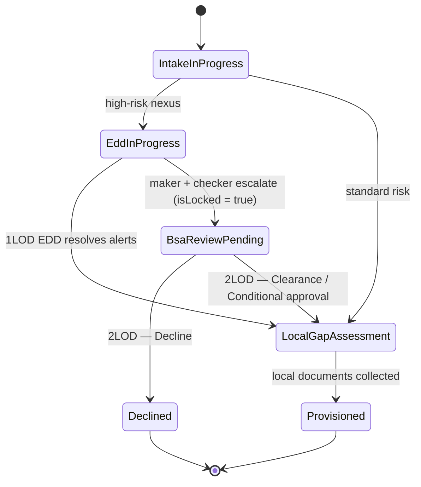

**Design notes**

- **Escalation is a node, not a state flag.** It carries evidence (trigger, maker, checker, timestamp) that a state value cannot. The state (`BsaReviewPending`) says *where* the case is; the escalation says *how it got there and who is accountable*.
- The **four-eyes rule** and the **system lock** are enforced in SHACL (🛡️ §6), not OWL, because they are rules about records, not about meaning.
- **Modelled, not yet enforced:** the *transitions*. Nothing stops a case jumping from `IntakeInProgress` straight to `Provisioned`. This is on the roadmap.
- **Lock scope gap:** the operating model says the lock applies "across all jurisdictions". In the data, `isLocked` sits on a `Case` that concerns `ex:Profile-US`. The Singapore extension that `extendsMaster` that profile has no case and no lock. See ⚠️ §14.

*Used by:* `EscalationShape`, `DispositionShape` · CQ4.

---

### 🕸️ 4.6 `correspondent` — respondent banks and nesting tiers

**Purpose.** Models correspondent banking: a correspondent bank serves a respondent bank, and a respondent may itself give *downstream* banks access (nested or "downstream" correspondent banking), which is a classic sanctions-evasion channel.

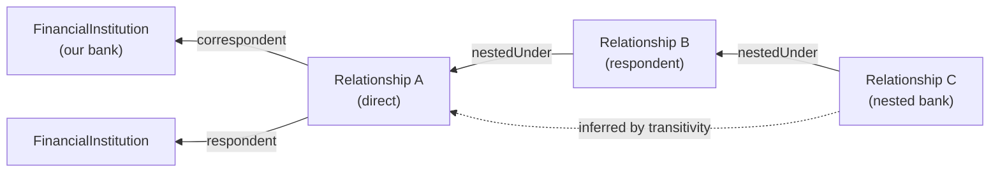

| Class | Sub-class of | Disjoint with | Definition |
|---|---|---|---|
| `kso:CorrespondentRelationship` | — | — | An account relationship in which a correspondent bank provides services to a respondent bank. |

| Property | Kind | Domain → Range | Characteristics | Definition |
|---|---|---|---|---|
| `kso:correspondent` | object | `kso:CorrespondentRelationship` → `kso:FinancialInstitution` | — | — |
| `kso:nestedUnder` | object | `kso:CorrespondentRelationship` → `kso:CorrespondentRelationship` | Transitive | Links a downstream (nested) relationship to the relationship it accesses the correspondent through. Transitive, so a reasoner can find every tier above a nested bank. |
| `kso:respondent` | object | `kso:CorrespondentRelationship` → `kso:FinancialInstitution` | — | — |
| `kso:cbddqReceivedOn` | datatype | `kso:CorrespondentRelationship` → `xsd:date` | — | Date the signed Wolfsberg Correspondent Banking Due Diligence Questionnaire was received. |
| `kso:permitsNestedAccess` | datatype | `kso:CorrespondentRelationship` → `xsd:boolean` | — | — |

**Design notes**

- `nestedUnder` is declared **transitive**, so a reasoner can find *every* tier above a nested bank, however deep.
- `cbddqReceivedOn` records receipt of the Wolfsberg CBDDQ, which the operating model's EDD mandate requires for respondent FIs.
- **Important caveat (verified):** KSO's validation runs **RDFS** inference, not OWL, so transitivity is never materialised. Asked for `nestedUnder` from tier C, plain SPARQL returns only B; `nestedUnder+` returns B and A. Until an OWL-RL reasoner runs, queries must use the `+` path. See 📐 §7.

```text
plain  kso:nestedUnder   from R3 → ['R2']
path   kso:nestedUnder+  from R3 → ['R2', 'R1']
```

*Used by:* no shape, no CQ, no example yet. This module is the least exercised (⚠️ §14).

---

### 🕸️ 4.7 `trade-finance` — transactions, shipments, vessels, goods

**Purpose.** Represents the trade-based money-laundering and sanctions surface: which **instrument**, which **parties**, which **route** (origin → transshipment → destination), which **vessel** under which **flag**, carrying which **goods** (HS code, dual-use flag).

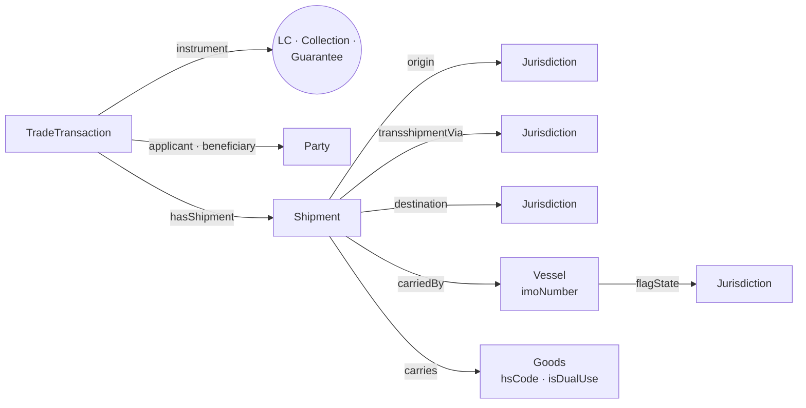

| Class | Sub-class of | Disjoint with | Definition |
|---|---|---|---|
| `kso:Goods` | — | — | — |
| `kso:Shipment` | — | — | — |
| `kso:TradeTransaction` | — | — | A bank-intermediated trade deal (letter of credit, documentary collection, guarantee). |
| `kso:Vessel` | — | — | — |

| Property | Kind | Domain → Range | Characteristics | Definition |
|---|---|---|---|---|
| `kso:applicant` | object | `kso:TradeTransaction` → `kso:Party` | — | — |
| `kso:beneficiary` | object | `kso:TradeTransaction` → `kso:Party` | — | — |
| `kso:carriedBy` | object | `kso:Shipment` → `kso:Vessel` | — | — |
| `kso:carries` | object | `kso:Shipment` → `kso:Goods` | — | — |
| `kso:destination` | object | `kso:Shipment` → `kso:Jurisdiction` | — | — |
| `kso:flagState` | object | `kso:Vessel` → `kso:Jurisdiction` | — | — |
| `kso:hasShipment` | object | `kso:TradeTransaction` → `kso:Shipment` | — | — |
| `kso:instrument` | object | `kso:TradeTransaction` → `skos:Concept` | — | — |
| `kso:origin` | object | `kso:Shipment` → `kso:Jurisdiction` | — | — |
| `kso:transshipmentVia` | object | `kso:Shipment` → `kso:Jurisdiction` | — | — |
| `kso:hsCode` | datatype | `kso:Goods` → `xsd:string` | — | Harmonized System tariff classification (at least 6 digits). |
| `kso:imoNumber` | datatype | `kso:Vessel` → `xsd:string` | — | — |
| `kso:isDualUse` | datatype | `kso:Goods` → `xsd:boolean` | — | True if the goods appear on a dual-use export-control list. |

**Design notes**

- Every leg of a route is a **jurisdiction node**, so the risk machinery (FATF status → EDD) applies to routes for free. CQ5 needs no trade-specific risk logic, only `origin|transshipmentVia|destination`.
- Vessels carry a **flag state**, a known sanctions-evasion vector (flag hopping), but no rule uses it yet.
- `isDualUse` is a boolean today. A richer model would link goods to a specific control-list entry (e.g. an EU Annex I or US CCL number) as a SKOS concept.

*Used by:* `GoodsShape`, `VesselShape` · CQ5.

---

## 🧩 5. Controlled Vocabularies — `vocabularies/`

### 🧩 5.1 Why SKOS instead of OWL classes

A case state, a risk tier or a FATF status is a **value you pick from a list**, not a *kind of thing with members*. `ksov:RiskHigh` has no instances, since nothing "is a" High. Modelling it as an OWL class would claim otherwise. SKOS (the W3C standard for code lists and thesauri) gives labels, definitions, notations for ordering, and scheme membership, without that false claim ([ADR-0004](adr/0004-reference-data-as-skos-vocabularies.md)).

Jurisdictions are the one deliberate **dual type**: each is both a `kso:Jurisdiction` (so domains and ranges work) and a `skos:Concept` (so it lives in a managed scheme with labels):

```turtle
ksoj:KE a kso:Jurisdiction , skos:Concept ;
    skos:inScheme ksoj:JurisdictionScheme ;
    skos:prefLabel "Kenya"@en ;
    kso:isoCountryCode "KE" ;
    kso:primaryRegulator "CBK" ;
    kso:hasFatfStatus ksov:FatfIncreasedMonitoring ;
    kso:hasRiskTier ksov:RiskHigh ;
    kso:requiresDocument ksod:KE-KraPinCertificate , ksod:KE-FormCr12DirectorsRegistry .
```

### 🧩 5.2 The policy-bearing scheme: FATF status

| Concept | Label | UBO threshold | Triggers EDD | Meaning |
|---|---|:---:|:---:|---|
| `ksov:FatfStandard` | Standard | 25% | — | Not subject to FATF increased monitoring or call for action |
| `ksov:FatfIncreasedMonitoring` | Increased Monitoring | **10%** | ✅ | On the FATF "grey list". Compresses the threshold and mandates EDD |
| `ksov:FatfCallForAction` | Call for Action | **10%** | ✅ | On the FATF "black list". *Outside risk appetite by default* (stated in the definition only; not enforced, see ⚠️ §14) |

### 🧩 5.3 The 20-jurisdiction matrix

Generated from `vocabularies/jurisdictions.ttl`. The **UBO threshold** column is not stored on the jurisdiction; it is *resolved* through `hasFatfStatus → uboThresholdPercent`, exactly as the tooling does.

| ISO | Jurisdiction | Regulator | FATF status | Risk tier | UBO threshold | EDD | Supplemental local documents |
|:---:|---|---|---|---|:---:|:---:|---|
| `US` | United States | OCC / FinCEN | Standard | Low-Medium | 25% | — | FinCEN CDD Form; Form W-9; State Registry Certificate |
| `GB` | United Kingdom | FCA / HM Treasury | Standard | Low | 25% | — | Companies House Extract; PSC Register |
| `SG` | Singapore | MAS | Standard | Low | 25% | — | ACRA BizFile Extract; Local Resident Director Verification |
| `KE` | Kenya | CBK | **Increased Monitoring** | High | **10%** | ✅ | Form CR12 Directors Registry; KRA PIN Certificate |
| `VN` | Vietnam | SBV | **Increased Monitoring** | High | **10%** | ✅ | Investment Registration Certificate; SBV Foreign Exchange Approval |
| `AE` | United Arab Emirates | CBUAE | Standard | Medium | 25% | — | DED Commercial License; Emirates ID for Local Signatories |
| `CH` | Switzerland | FINMA | Standard | Low | 25% | — | Form A Beneficial Owner Declaration; Zefix Registry Extract |
| `HK` | Hong Kong | HKMA | Standard | Low | 25% | — | Business Registration Certificate; TCSP Certification |
| `DE` | Germany | BaFin | Standard | Low | 25% | — | Handelsregister Extract; Transparenzregister Extract |
| `BR` | Brazil | BACEN | Standard | Medium | 25% | — | BACEN Foreign Investment Registration; CNPJ National Tax ID |
| `ZA` | South Africa | SARB | Standard | Medium | 25% | — | CIPC Registration Certificate; SARB Exchange Control Approval |
| `AU` | Australia | AUSTRAC | Standard | Low | 25% | — | ASIC Current Company Extract; Director Identity Verification |
| `IN` | India | RBI | Standard | Medium | 25% | — | Corporate PAN Card; FEMA Compliance Attestation |
| `JP` | Japan | JFSA | Standard | Low | 25% | — | Hojin Bangou Corporate Number; Tokibo Tohon Registry Certificate |
| `MX` | Mexico | CNBV | Standard | Medium-High | 25% | — | FIEL Electronic Signature; RFC Federal Tax Registry |
| `AO` | Angola | BNA | **Increased Monitoring** | High | **10%** | ✅ | BNA Capital Importation License; DAR Revenue Collection Receipt |
| `CA` | Canada | FINTRAC | Standard | Low | 25% | — | Articles of Amendment; Provincial Corporate Registry Profile |
| `FR` | France | ACPR | Standard | Low | 25% | — | Kbis Extract; RBE Beneficial Ownership Filing |
| `BO` | Bolivia | ASFI | **Increased Monitoring** | High | **10%** | ✅ | Commercial Registry Certificate; NIT Tax ID |
| `IQ` | Iraq | CBI | **Increased Monitoring** | High | **10%** | ✅ | Central Bank AML Approval; Ministry of Trade Corporate Registration |

> **Point-in-time check.** All five Increased Monitoring statuses (Kenya, Vietnam, Angola, Bolivia, Iraq) match the FATF list published after the **19 June 2026** plenary. The other 15 jurisdictions are not on it, so `FatfStandard` is correct for them. The next plenary is in **October 2026**: re-verify then and bump `dcterms:modified` on `ksoj:JurisdictionScheme`. Source: [FATF — Jurisdictions under Increased Monitoring, 19 June 2026](https://www.fatf-gafi.org/content/fatf-gafi/en/publications/High-risk-and-other-monitored-jurisdictions/increased-monitoring-june-2026.html).
>
> Risk tiers are the operating model's own classification, not an external list.

### 🧩 5.4 Every other scheme

**`ksov:AlertDispositionScheme`** — Alert disposition

| Concept | Label | Extra |
|---|---|---|
| `ksov:AlertPending` | Pending review | — |
| `ksov:FalsePositive` | False positive | — |
| `ksov:PossibleTrueMatch` | Possible true match | — |

**`ksov:CaseStateScheme`** — Case state

| Concept | Label | Extra |
|---|---|---|
| `ksov:BsaReviewPending` | 2LOD BSA review pending | `skos:notation` 2LOD_BSA_Review_Pending |
| `ksov:Declined` | Declined | — |
| `ksov:EddInProgress` | EDD in progress | — |
| `ksov:IntakeInProgress` | Intake in progress | — |
| `ksov:LocalGapAssessment` | Local gap assessment | — |
| `ksov:Provisioned` | Provisioned | — |

**`ksov:ControlBasisScheme`** — Control basis

| Concept | Label | Extra |
|---|---|---|
| `ksov:BoardAppointmentRight` | Right to appoint the board | — |
| `ksov:SeniorManagingOfficial` | Senior managing official | — |

**`ksov:DispositionOutcomeScheme`** — 2LOD disposition outcome

| Concept | Label | Extra |
|---|---|---|
| `ksov:Clearance` | Clearance | — |
| `ksov:ConditionalApproval` | Conditional approval | — |
| `ksov:Decline` | Decline | — |

**`ksov:DocumentTypeScheme`** — Document type

| Concept | Label | Extra |
|---|---|---|
| `ksov:ArticlesOfIncorporation` | Articles of Incorporation / Certificate of Formation | — |
| `ksov:CertificateOfGoodStanding` | Certificate of Good Standing | — |
| `ksov:CorporateResolution` | Corporate resolution designating signatories | — |
| `ksov:CustomerSupplierLists` | Primary customer and supplier lists | — |
| `ksov:FinCenCddCertification` | FinCEN CDD beneficial ownership certification | — |
| `ksov:FormW9` | IRS Form W-9 / EIN verification | — |
| `ksov:GovernmentPhotoId` | Government-issued photo ID | — |
| `ksov:OwnershipChart` | Ownership and control organisational chart | — |
| `ksov:ProofOfAddress` | Proof of residential address | — |
| `ksov:RespondentAmlPolicy` | Respondent AML policy | — |
| `ksov:SourceOfFundsEvidence` | Source of funds corroboration | — |
| `ksov:SourceOfWealthEvidence` | Source of wealth corroboration | — |
| `ksov:WolfsbergCbddq` | Wolfsberg CBDDQ | — |

**`ksov:EscalationTriggerScheme`** — Escalation trigger

| Concept | Label | Extra |
|---|---|---|
| `ksov:RegulatoryConflict` | Irreconcilable cross-border regulatory conflict | — |
| `ksov:SuspectedTrueMatch` | Suspected true sanctions match | — |
| `ksov:UnmitigatedHighRisk` | Unmitigated high risk post-EDD | — |

**`ksov:FatfStatusScheme`** — FATF jurisdiction status

| Concept | Label | Extra |
|---|---|---|
| `ksov:FatfCallForAction` | Call for Action | `kso:uboThresholdPercent` 10; `kso:triggersEdd` true |
| `ksov:FatfIncreasedMonitoring` | Increased Monitoring | `kso:uboThresholdPercent` 10; `kso:triggersEdd` true |
| `ksov:FatfStandard` | Standard | `kso:uboThresholdPercent` 25; `kso:triggersEdd` false |

**`ksov:LineOfDefenceScheme`** — Line of defence

| Concept | Label | Extra |
|---|---|---|
| `ksov:FirstLine` | 1LOD Operations | — |
| `ksov:SecondLine` | 2LOD BSA Compliance | — |
| `ksov:ThirdLine` | 3LOD Regulators | — |

**`ksov:RiskFactorScheme`** — Risk factor type

| Concept | Label | Extra |
|---|---|---|
| `ksov:DualUseGoods` | Dual-use goods | — |
| `ksov:FatfNexus` | FATF high-risk jurisdiction nexus | — |
| `ksov:NestedAccess` | Nested correspondent access | — |
| `ksov:OpaqueOwnership` | Opaque ownership structure | — |
| `ksov:PepConnection` | Politically exposed person connection | — |

**`ksov:RiskTierScheme`** — Risk tier

| Concept | Label | Extra |
|---|---|---|
| `ksov:RiskLow` | Low | `skos:notation` 1 |
| `ksov:RiskLowMedium` | Low-Medium | `skos:notation` 2 |
| `ksov:RiskMedium` | Medium | `skos:notation` 3 |
| `ksov:RiskMediumHigh` | Medium-High | `skos:notation` 4 |
| `ksov:RiskHigh` | High | `skos:notation` 5 |

**`ksov:TradeInstrumentScheme`** — Trade instrument

| Concept | Label | Extra |
|---|---|---|
| `ksov:BankGuarantee` | Bank guarantee | — |
| `ksov:DocumentaryCollection` | Documentary collection | — |
| `ksov:LetterOfCredit` | Documentary letter of credit | — |

---

## 🛡️ 6. SHACL Shape Catalogue — `shapes/kso-shapes.ttl`

### 📐 6.1 Open world vs closed world, in one table

| | OWL (`ontology/`) | SHACL (`shapes/`) |
|---|---|---|
| Assumption | **Open world**: a missing fact is *unknown* | **Closed world**: a missing fact is a *violation* |
| Job | Say what terms **mean** | Say what a valid **record** must contain |
| On bad data | Silently *infers* new facts, or declares the *whole graph* inconsistent | Reports the **exact node, path and a human message** |
| Right tool for | Classification, meaning, reasoning | Data quality, policy, onboarding gates |

KYC is a closed-world problem: *"we do not hold the UBO's passport"* is a finding that blocks onboarding, not an unknown ([ADR-0002](adr/0002-shacl-for-validation-owl-for-meaning.md)).

### 🛡️ 6.2 How validation runs

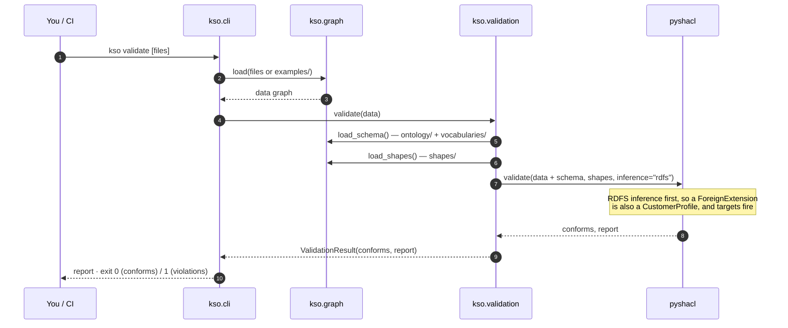

Two design choices in that flow:

1. **Schema is merged into the data before validating.** `ex:Harbourline` says it is incorporated in `ksoj:KE`, but Kenya's FATF status lives in `vocabularies/`. Without the merge, `JurisdictionShape` could not resolve the threshold path.
2. **`inference="rdfs"`, not OWL.** RDFS gives subclass typing (needed so `CustomerProfileShape` also checks foreign extensions) without OWL's surprise inferences.

### 🛡️ 6.3 Shape-by-shape

| # | Shape | Target | Constraints | Violation message | Operating-model source |
|:--:|---|---|---|---|---|
| 1 | `PartyShape` | `kso:Party` | `legalName`: exactly 1, `xsd:string`, min length 1 | "Every party needs exactly one non-empty legal name." | KYB/KYC data mandates |
| 2 | `LegalEntityShape` | `kso:LegalEntity` | `incorporatedIn`: exactly 1, `sh:class kso:Jurisdiction` · `leiCode`: ≤1, pattern `^[A-Z0-9]{18}[0-9]{2}$` · **SPARQL:** Σ direct stakes ≤ 100 | "A legal entity must be incorporated in exactly one known jurisdiction." · "LEI must be 20 characters…" · "Direct ownership stakes in {$this} sum to {?total}%…" | KYB; deterministic identifiers; data integrity |
| 3 | `OwnershipStakeShape` | `kso:OwnershipStake` | `holder` 1 (`Party`) · `heldIn` 1 (`LegalEntity`) · `percentage` 1, decimal, `(0, 100]` | "Stake percentage must be a decimal in (0, 100]." | Ownership chart |
| 4 | `JurisdictionShape` | `kso:Jurisdiction` | `isoCountryCode` 1, `^[A-Z]{2}$` · path `(hasFatfStatus uboThresholdPercent)` exactly 1 | "Jurisdiction must resolve to exactly one UBO threshold via its FATF status." | Dynamic UBO traversal |
| 5 | `CustomerProfileShape` | `kso:CustomerProfile` | `profileOf` 1 (`Party`) · `bookedIn` 1 (`Jurisdiction`) | *(default messages)* | Master/extension model |
| 6 | `ForeignExtensionShape` | `kso:ForeignExtension` | `extendsMaster` 1 (`MasterProfile`) · **SPARQL:** extension and master describe the same party | "US Master Anchor Mandate: a foreign extension must extend exactly one master profile." · "…must describe the same party." | **US Master Anchor Mandate** |
| 7 | `ScreeningAlertShape` | `kso:ScreeningAlert` | `raisedBy` ≥1 · `matchScore` ≤1, decimal in [0, 1] · `alertDisposition` 1, `sh:in` (Pending, FalsePositive, PossibleTrueMatch) | *(default messages)* | Screening & EDD |
| 8 | `EscalationShape` | `kso:Escalation` | `escalatedCase` 1 · `escalationTrigger` ≥1, `sh:in` 3 triggers · `maker` 1 · `checker` 1, **`sh:disjoint kso:maker`** · **SPARQL:** case must be locked | "Four-eyes principle: the checker cannot be the maker." · "An approved escalation must lock its case…" | **Dual-control handoff & system lock** |
| 9 | `DispositionShape` | `kso:Disposition` | `disposes` 1 (`Escalation`) · `outcome` 1, `sh:in` (Decline, ConditionalApproval, Clearance) | *(default messages)* | 2LOD adjudication |
| 10 | `GoodsShape` | `kso:Goods` | `hsCode` ≥1, `^[0-9]{6,10}$` · `isDualUse` exactly 1 boolean | "HS code must be 6–10 digits." | Trade screening |
| 11 | `VesselShape` | `kso:Vessel` | `imoNumber` 1, `^IMO[0-9]{7}$` | *(default message)* | Trade screening |

### 🛡️ 6.4 The three SHACL-SPARQL constraints, explained

Core SHACL can check one node's own values. **Cross-node** rules need SHACL-SPARQL: a `SELECT` that returns one row per violation, with `$this` bound to the node being checked.

**(a) Stakes cannot exceed 100%.** This aggregates across *other* nodes (the stakes) that point at `$this`:

```sparql
SELECT $this ?total
WHERE {
    ?stake kso:heldIn $this ;
           kso:percentage ?pct .
}
GROUP BY $this
HAVING (SUM(?pct) > 100)
```

> ⚠️ **Verified defect.** `?total` is named in the `SELECT` but never bound, so the message prints the literal text `{?total}%` (see the screenshot below). The rule still fires correctly; only the message is wrong. **Fix (tested; the bundled example still conforms):**
> ```diff
> -            SELECT $this ?total
> +            SELECT $this (SUM(?pct) AS ?total)
> ```
> After the fix the message reads *"…sum to 110.0%, which exceeds 100%."* The existing test passed anyway because it only asserts `"exceeds 100%" in result.report`. Assert on `"110.0%"` too, so the test catches this kind of defect.

**(b) US Master Anchor Mandate: same party.** Cardinality alone (`extendsMaster` exactly 1) would let a Singapore extension of *Company A* hang off the US master of *Company B*. This closes that hole:

```sparql
SELECT $this
WHERE {
    $this   kso:profileOf ?party ;
            kso:extendsMaster ?master .
    ?master kso:profileOf ?masterParty .
    FILTER (?party != ?masterParty)
}
```

**(c) System lock.** Escalation without a lock would leave 1LOD able to provision a file that 2LOD hasn't decided on:

```sparql
SELECT $this
WHERE {
    $this kso:escalatedCase ?case .
    FILTER NOT EXISTS { ?case kso:isLocked true }
}
```

**`sh:disjoint`, the one-line four-eyes rule.** "No value of `checker` may equal any value of `maker` on the same node":

```turtle
sh:property [
    sh:path kso:checker ;
    sh:disjoint kso:maker ;
    sh:message "Four-eyes principle: the checker cannot be the maker." ;
] .
```

### 📊 6.5 Screenshot — shapes rejecting a deliberately broken record

The file fed in below breaks five rules at once: maker = checker, an unlocked escalated case, an orphan foreign extension, a malformed LEI, and stakes summing to 110%.

```turtle
ex:Overowned a kso:LegalEntity ; kso:legalName "Overowned Trading Ltd" ;
    kso:incorporatedIn ksoj:GB ; kso:leiCode "BAD-LEI" .
ex:S1 a kso:OwnershipStake ; kso:holder ex:Alice ; kso:heldIn ex:Overowned ; kso:percentage 70.0 .
ex:S2 a kso:OwnershipStake ; kso:holder ex:Bob   ; kso:heldIn ex:Overowned ; kso:percentage 40.0 .
ex:Ext-HK a kso:ForeignExtension ; kso:profileOf ex:Overowned ; kso:bookedIn ksoj:HK .   # no master
ex:Case-9 a kso:Case .                                                                 # not locked
ex:Esc-9 a kso:Escalation ; kso:escalatedCase ex:Case-9 ;
    kso:escalationTrigger ksov:SuspectedTrueMatch ; kso:maker ex:Alice ; kso:checker ex:Alice .
```

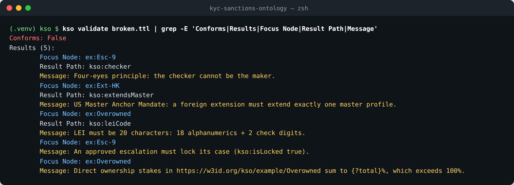

*Figure 2. Every violation names the **record** (focus node), the **field** (result path) and a **message a 1LOD analyst can act on**. Note the last line: the unbound `{?total}` defect described above.*

---

## 📐 7. Axioms, Characteristics and Design Decisions

### 📐 7.1 What each OWL axiom does, and when it actually runs

| Axiom | Where | What it *means* | Enforced at runtime today? |
|---|---|---|---|
| `rdfs:subClassOf` | Party hierarchy, profiles | Every `ForeignExtension` is a `CustomerProfile` | ✅ via RDFS inference in `pyshacl` |
| `rdfs:domain` / `rdfs:range` | every property | *Licenses inference* of types; never rejects data | ✅ inferred (RDFS), not as a check |
| `owl:disjointWith` | `NaturalPerson`/`LegalEntity`, `MasterProfile`/`ForeignExtension` | Nothing can be both | ⚠️ not checked (needs an OWL reasoner). The UBO walk relies on the *type*, not the axiom |
| `owl:FunctionalProperty` | `incorporatedIn`, `bookedIn`, `profileOf`, `extendsMaster`, `holder`, `heldIn`, `percentage`, `hasFatfStatus`, `hasRiskTier`, `caseState` | At most one value | ⚠️ not by OWL. ✅ restated as `sh:maxCount 1` for 7 of the 10. `hasFatfStatus` is covered only indirectly (via the threshold path); `hasRiskTier` and `caseState` are not checked |
| `owl:TransitiveProperty` | `nestedUnder` | Tier chains close transitively | ⚠️ not materialised. Use `nestedUnder+` in SPARQL |

**The lesson in this table.** OWL axioms are *statements of meaning* that a reasoner may use. They are not validation. KSO declares them because they are true and document intent, and because a future OWL-RL pass (`owlrl` is already installed as a `pyshacl` dependency) can exploit them. Every rule that must **block** bad data is restated in SHACL. If you ever find yourself relying on an OWL axiom to catch an error, move that rule to `shapes/`.

> **A trap to know about.** `kso:heldIn rdfs:range kso:LegalEntity` does **not** mean "a stake held in a person is invalid". Under inference it means "whatever a stake is held in *is* a LegalEntity". Point a stake at `ex:Alice` and a reasoner will quietly type Alice as a company. SHACL's `sh:class kso:LegalEntity` on `OwnershipStakeShape` is what actually rejects it.

### 📐 7.2 Architecture Decision Records

| ADR | Decision | Consequence you can see in the code |
|---|---|---|
| [0001](adr/0001-model-roles-and-relationships-not-types.md) | Model **roles and relationships**, not types. UBO is a determination; customer is a profile | `OwnershipStake`, `BeneficialOwnerDetermination`, `CustomerProfile` exist; `UBO` and `Customer` classes don't |
| [0002](adr/0002-shacl-for-validation-owl-for-meaning.md) | **SHACL for validation, OWL for meaning** | Every policy rule lives in `shapes/`; validation uses RDFS inference only |
| [0003](adr/0003-graph-for-facts-code-for-arithmetic.md) | **Graph for facts and policy, code for arithmetic** | Look-through ownership is Python; the threshold it compares against is read from the graph |
| [0004](adr/0004-reference-data-as-skos-vocabularies.md) | **Reference data as SKOS**, separate from the ontology | `vocabularies/` versioned apart; threshold stated once per FATF status |

---

## ⚓ 8. Worked Example — Harbourline Commodities Ltd (fictional)

`examples/harbourline-commodities.ttl`: 109 triples that exercise six of the seven modules (all but `correspondent`) in one coherent story.

> **The story.** A Kenyan commodities trader, already anchored on a **US master profile**, wants a local account in **Singapore**. Kenya's FATF grey-listing compresses the UBO threshold to **10%**, which pulls a **12%** shareholder into scope. An indirect owner, reached through a UAE holding company, returns a **0.91 match against OFAC SDN**. The case is **escalated under dual control and locked**. Meanwhile the bank is financing a **coffee shipment Kenya → UAE → Vietnam** under a letter of credit.

### 📊 8.1 Screenshot — the instance graph

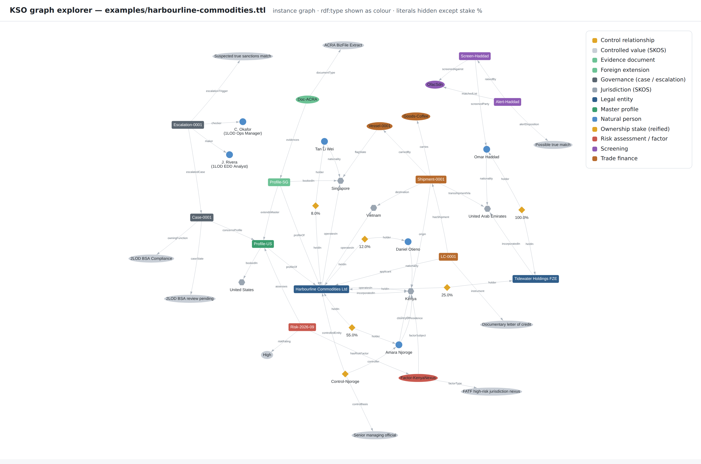

*Figure 3. Every node and edge is generated from the example file (literals are hidden except stake percentages, and `rdf:type` is shown as colour). The gold diamonds are **reified ownership stakes**, so you can see the pattern from §4.2 in the data: people and companies never connect to each other directly, only through a stake node.*

### ⚓ 8.2 Ownership structure

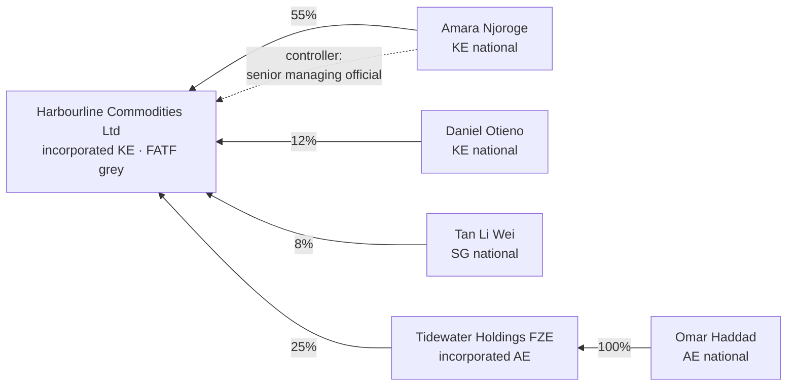

### 🧭 8.3 The example, step by step through the operating model

| Step | What happens | Triples that make it true | How the machine knows |
|---|---|---|---|
| **1. Intake** | Harbourline is registered and its hierarchy mapped | `ex:Harbourline kso:incorporatedIn ksoj:KE` · 5 `OwnershipStake` nodes · 1 `ControlRelationship` | `kso validate` → conforms |
| **2. Threshold** | Kenya → Increased Monitoring → **10%** | `ksoj:KE kso:hasFatfStatus ksov:FatfIncreasedMonitoring` · `ksov:FatfIncreasedMonitoring kso:uboThresholdPercent 10` | `kso ubo` prints "Threshold applied: 10%" |
| **3. UBO traversal** | Njoroge 55%, Haddad 25% (indirect), Otieno 12% are in scope; Tan 8% is not | stakes × chain | `kso.ownership.effective_ownership` (§10) |
| **4. EDD** | EDD is required for two independent reasons | Kenya & Vietnam in `operatesIn`; `ex:Risk-2026-09 kso:eddRequired true` | CQ2 |
| **5. Screening** | Haddad screened against OFAC SDN, alert at 0.91, *possible true match* | `ex:Screen-Haddad`, `ex:Alert-Haddad` | `ScreeningAlertShape` |
| **6. Escalation** | Rivera (maker) → Okafor (checker); case locked; `2LOD BSA review pending` | `ex:Escalation-0001`, `ex:Case-0001 kso:isLocked true` | CQ4 · four-eyes + lock shapes |
| **7. Gap assessment** | Singapore requires 2 local documents; 1LOD holds 1 | `ksoj:SG kso:requiresDocument …` · `ex:Doc-ACRA kso:evidences ex:Profile-SG` | CQ3 → *Local Resident Director Verification* |
| **8. Trade** | LC-0001 ships coffee (HS 090111, not dual-use) KE → AE → VN on an SG-flagged vessel | `ex:Shipment-0001 kso:origin ksoj:KE ; kso:transshipmentVia ksoj:AE ; kso:destination ksoj:VN` | CQ5 → Kenya and Vietnam legs flagged |

### ⚓ 8.4 The key individuals, in Turtle

```turtle
# Master + extension: same party, two booking jurisdictions
ex:Profile-US a kso:MasterProfile ;
    kso:profileOf ex:Harbourline ;
    kso:bookedIn  ksoj:US .

ex:Profile-SG a kso:ForeignExtension ;
    kso:profileOf     ex:Harbourline ;
    kso:bookedIn      ksoj:SG ;
    kso:extendsMaster ex:Profile-US .          # the US Master Anchor Mandate, satisfied

# Screening alert on the indirect owner
ex:Alert-Haddad a kso:ScreeningAlert ;
    kso:raisedBy         ex:Screen-Haddad ;
    kso:matchedList      ex:OfacSdn ;
    kso:matchScore       0.91 ;
    kso:alertDisposition ksov:PossibleTrueMatch .

# Dual-control escalation and the lock it requires
ex:Case-0001 a kso:Case ;
    kso:concernsProfile ex:Profile-US ;
    kso:caseState       ksov:BsaReviewPending ;
    kso:isLocked        true ;
    kso:owningFunction  ksov:SecondLine .

ex:Escalation-0001 a kso:Escalation ;
    kso:escalatedCase     ex:Case-0001 ;
    kso:escalationTrigger ksov:SuspectedTrueMatch ;
    kso:maker             ex:AnalystRivera ;
    kso:checker           ex:ManagerOkafor ;
    kso:escalatedOn       "2026-09-17T14:05:00Z"^^xsd:dateTime .
```

---

## 🔤 9. Competency Questions — `queries/`

A **competency question** is a real business question the ontology must be able to answer. It is how you *prove* an ontology is fit for purpose, instead of just asserting it. Each `.rq` file is one question, and each has a test pinning its expected answer (§11).

| ID | Question | Operating-model step | Key SPARQL pattern |
|---|---|---|---|
| CQ1 | Which natural persons **directly** hold ≥ the applicable UBO threshold? | Dynamic UBO traversal | Property path to threshold · `FILTER` numeric compare |
| CQ2 | Which master profiles require **EDD**, and why? | Screening & EDD | `UNION` of two independent routes · `BIND(CONCAT…)` for explanation |
| CQ3 | Which **locally required documents** are still missing? | Foreign gap assessment → RFI | *Required minus collected*: `FILTER NOT EXISTS` |
| CQ4 | Which cases are **locked awaiting 2LOD**, with maker, checker, trigger? | 1LOD → 2LOD escalation | Chained paths (`a/b/c`) · negation for "not yet disposed" |
| CQ5 | Which trade deals touch an **EDD jurisdiction** or carry **dual-use** goods? | Trade-finance screening | Alternative path `origin\|transshipmentVia\|destination` |

### 🔤 9.1 CQ1 — direct owners at or above threshold

```sparql
SELECT ?entityName ?personName ?percentage ?threshold ?jurisdiction
WHERE {
    ?entity a kso:LegalEntity ;
            kso:legalName ?entityName ;
            kso:incorporatedIn ?j .
    ?j skos:prefLabel ?jurisdiction ;
       kso:hasFatfStatus/kso:uboThresholdPercent ?threshold .   # policy read from the graph

    ?stake kso:heldIn ?entity ;
           kso:holder ?person ;
           kso:percentage ?percentage .
    ?person a kso:NaturalPerson ;
            kso:legalName ?personName .

    FILTER (?percentage >= ?threshold)
}
ORDER BY ?entityName DESC(?percentage)
```

**Read it as:** "for every company, find its country's threshold via FATF status; find every *person* holding a stake in it; keep those at or above the threshold." CQ1 is **deliberately direct-only**. Haddad appears only against Tidewater (100%, UAE → 25%), not against Harbourline. That limitation is the reason §10 exists.

### 🔤 9.2 CQ2 — EDD triggers, with reasons

```sparql
SELECT DISTINCT ?partyName ?profile ?reason
WHERE {
    ?profile a kso:MasterProfile ; kso:profileOf ?party .
    ?party kso:legalName ?partyName .
    {   # route (a): any FATF nexus that triggers EDD
        ?party kso:incorporatedIn|kso:operatesIn ?j .
        ?j kso:hasFatfStatus ?status ; skos:prefLabel ?jName .
        ?status kso:triggersEdd true ; skos:prefLabel ?statusName .
        BIND (CONCAT("FATF nexus: ", STR(?jName), " (", STR(?statusName), ")") AS ?reason)
    }
    UNION
    {   # route (b): an explicit risk-assessment conclusion
        ?assessment kso:assesses ?profile ; kso:eddRequired true ; kso:assessedOn ?date .
        BIND (CONCAT("Risk assessment of ", STR(?date), " requires EDD") AS ?reason)
    }
}
```

**Why it returns reasons, not just "yes".** An EDD flag without a reason is useless to an analyst and unacceptable to an examiner. `BIND(CONCAT(…))` turns the path the query matched into an explanation. This is *explainability by construction*, and it is one of the strongest arguments for a symbolic layer under any future AI component.

### 🔤 9.3 CQ3 — the automated RFI: required minus collected

```sparql
SELECT ?partyName ?bookedIn ?missingDocument
WHERE {
    ?extension a kso:ForeignExtension ;
               kso:profileOf/kso:legalName ?partyName ;
               kso:bookedIn ?j .
    ?j skos:prefLabel ?bookedIn ;
       kso:requiresDocument ?docType .          # what the regulator requires…
    ?docType skos:prefLabel ?missingDocument .
    FILTER NOT EXISTS {                         # …minus what 1LOD already holds
        ?doc kso:evidences ?extension ;
             kso:documentType ?docType .
    }
}
```

### 🔤 9.4 CQ4 — locked escalations awaiting 2LOD

```sparql
SELECT ?case ?partyName ?trigger ?makerName ?checkerName ?escalatedOn
WHERE {
    ?case a kso:Case ;
          kso:caseState ksov:BsaReviewPending ;
          kso:isLocked true ;
          kso:concernsProfile/kso:profileOf/kso:legalName ?partyName .
    ?escalation kso:escalatedCase ?case ;
                kso:escalationTrigger/skos:prefLabel ?trigger ;
                kso:maker/kso:legalName ?makerName ;
                kso:checker/kso:legalName ?checkerName ;
                kso:escalatedOn ?escalatedOn .
    FILTER NOT EXISTS { ?disposition kso:disposes ?escalation }   # not yet decided
}
ORDER BY ?escalatedOn
```

### 🔤 9.5 CQ5 — trade-route and dual-use exposure

```sparql
SELECT DISTINCT ?transaction ?applicantName ?exposure
WHERE {
    ?transaction a kso:TradeTransaction ;
                 kso:applicant/kso:legalName ?applicantName ;
                 kso:hasShipment ?shipment .
    {
        ?shipment kso:origin|kso:transshipmentVia|kso:destination ?j .
        ?j kso:hasFatfStatus/kso:triggersEdd true ; skos:prefLabel ?jName .
        BIND (CONCAT("Route touches ", STR(?jName)) AS ?exposure)
    }
    UNION
    {
        ?shipment kso:carries ?goods .
        ?goods kso:isDualUse true ; kso:hsCode ?hs .
        BIND (CONCAT("Dual-use goods, HS ", ?hs) AS ?exposure)
    }
}
```

### 📊 9.6 Screenshots — all five questions answered

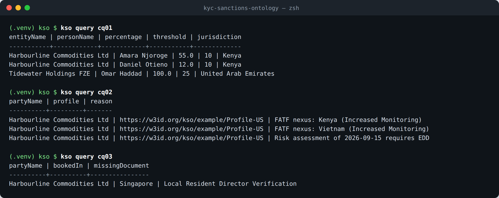

*Figure 4. CQ1 applies **two different thresholds in one query** (10% for Kenya, 25% for the UAE), both read from the graph. CQ2 gives three reasons for EDD. CQ3 produces the one-line RFI.*

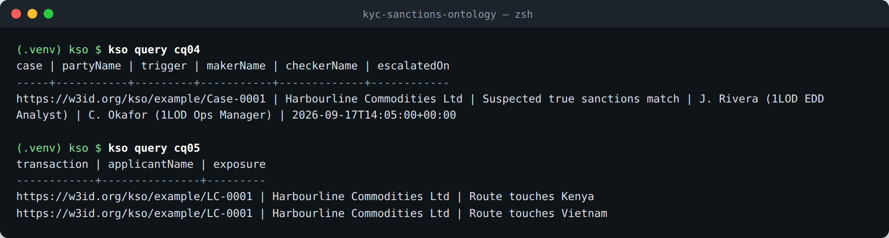

*Figure 5. CQ4 shows the locked case with maker and checker. CQ5 flags the Kenya and Vietnam legs. The UAE transshipment leg is **not** flagged, because the UAE's status is Standard.*

---

## 🌉 10. The Symbolic–Procedural Bridge — `src/kso/`

### 🌉 10.1 Why there is any Python at all

SPARQL property paths can **follow** a chain of any length (`kso:heldIn+`), but they cannot **multiply** values along it. Look-through ownership is multiplication: 100% of a company that owns 25% is an effective 25%. The workaround, a `UNION` per chain depth, hard-codes a maximum depth, and it silently misses the deepest structures, which are exactly the ones built to obscure ownership ([ADR-0003](adr/0003-graph-for-facts-code-for-arithmetic.md)).

So the division of labour is:

| The graph owns | The code owns |
|---|---|
| Facts (stakes, types) | Recursive multiply-and-sum |
| Policy (threshold on the FATF status) | Cycle protection |
| Meaning (`NaturalPerson` vs `LegalEntity`) | Sorting and presentation |

The threshold is **read from the graph, never hard-coded in Python**. A policy change is therefore a data change, and the code never needs a release for it.

### 🌉 10.2 Package map

| Module | Responsibility | Key functions |
|---|---|---|
| `graph.py` | Locate and load Turtle; bind prefixes; keep schema, shapes and data as separate graphs | `load`, `load_schema`, `load_shapes`, `load_knowledge_graph` |
| `ownership.py` | Look-through beneficial ownership | `direct_stakes`, `effective_ownership`, `ubo_threshold`, `reportable_owners` |
| `validation.py` | Run SHACL with RDFS inference | `validate → ValidationResult(conforms, report)` |
| `cli.py` | The `kso` command | `validate`, `query`, `ubo` |

### 🌉 10.3 The algorithm

```python
def effective_ownership(graph: Graph, entity: URIRef) -> dict[URIRef, Decimal]:
    """Each natural person's look-through percentage of `entity`."""
    totals: dict[URIRef, Decimal] = defaultdict(Decimal)

    def walk(current: URIRef, share: Decimal, visited: frozenset[URIRef]) -> None:
        for holder, percent in direct_stakes(graph, current):
            holder_share = share * percent / HUNDRED
            if (holder, RDF.type, KSO.NaturalPerson) in graph:
                totals[holder] += holder_share                        # a human: record, stop
            elif holder not in visited:                               # circular-ownership guard
                walk(holder, holder_share, visited | {holder})        # a company: look through

    walk(entity, HUNDRED, frozenset({entity}))
    return dict(totals)
```

**Trace on Harbourline** (`share` starts at 100):

| Depth | At node | Stake | Holder | Holder type | `share × pct / 100` | Action |
|:--:|---|---:|---|---|---:|---|
| 0 | Harbourline | 55% | Amara Njoroge | NaturalPerson | 100 × 55 / 100 = **55** | record |
| 0 | Harbourline | 12% | Daniel Otieno | NaturalPerson | 100 × 12 / 100 = **12** | record |
| 0 | Harbourline | 8% | Tan Li Wei | NaturalPerson | 100 × 8 / 100 = **8** | record |
| 0 | Harbourline | 25% | Tidewater Holdings FZE | LegalEntity | 100 × 25 / 100 = 25 | **recurse** with share 25 |
| 1 | Tidewater | 100% | Omar Haddad | NaturalPerson | 25 × 100 / 100 = **25** | record |

Then `reportable_owners` keeps everyone ≥ **10%** (read from Kenya's FATF status): **Njoroge 55, Haddad 25, Otieno 12**. Tan (8) drops out.

**Four Python habits worth copying from this file**

1. **`Decimal`, not `float`.** In floating point `0.1 + 0.2 == 0.30000000000000004`. Regulatory percentages need exact arithmetic, and `Decimal(str(literal))` avoids importing float error from the parser.
2. **A nested function (`walk`) closing over `totals`.** The recursion stays private to the one function that needs it, and there is no global state.
3. **`frozenset` for `visited`, passed down rather than mutated.** Each branch of the recursion gets its own view of "where I've been". A company reached by two different paths is still counted on both (correct: two chains, two contributions), but a *cycle* on one path is stopped.
4. **`@dataclass(frozen=True)` for `BeneficialOwner`.** It is a small, named, immutable record, which reads better than a bare tuple `(uri, "Omar", 25)`.

### 📊 10.4 Screenshot — validate and look-through UBO

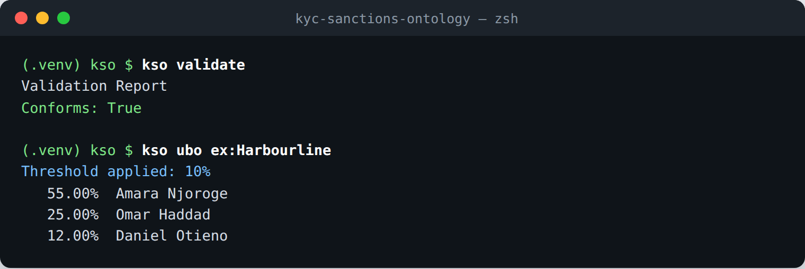

*Figure 6. The bundled example conforms to every shape that targets its nodes (it has no `Disposition` yet, so `DispositionShape` has nothing to check). The UBO report applies Kenya's 10% threshold and includes Omar Haddad at 25%, a stake that exists nowhere in the data as a single number.*

---

## 📊 11. Verification — `tests/` and CI

| Group | Tests | What it proves |
|---|:--:|---|
| Parsing | 12 | Every `.ttl` file in `ontology/`, `vocabularies/`, `shapes/`, `examples/` is valid Turtle |
| SHACL policy | 5 | The example **conforms**, *and* each key rule **rejects** a deliberately broken record: maker = checker · unlocked escalation · stakes > 100% · orphan foreign extension |
| Ownership | 5 | Indirect stakes multiply · Kenya compresses to 10% · correct owner order · a 25% rule would miss Otieno · circular ownership terminates |
| Competency questions | 5 | CQ1–CQ5 return exactly the expected rows |
| **Total** | **27** | |

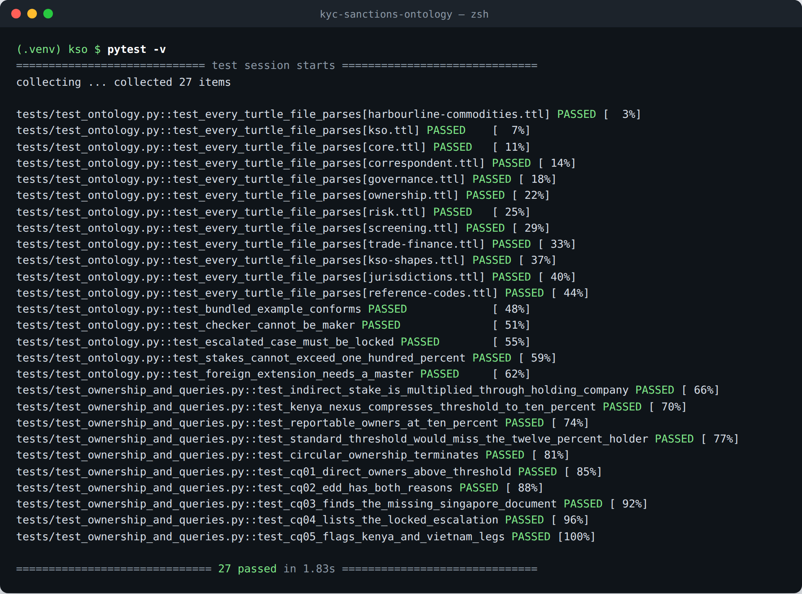

*Figure 7. The full suite, captured from a real run: 27 passed.*

**Why negative tests matter most.** A rule that never fires looks exactly like a rule that doesn't exist. Each policy shape has a test that feeds it a violating record and asserts it is caught. The `{?total}` defect in §6.4 shows the next level: assert on the **content of the message**, not just that a message appeared.

**CI.** `.github/workflows/validate.yml` runs on every push to `main` and on every pull request, on a Python **3.10 and 3.12** matrix: `pip install -e ".[dev]"` → `pytest -v` → `kso validate`. A reviewer sees a green check instead of having to take your word for it.

---

## 💻 12. Running It Locally

```bash
python3 -m venv .venv && source .venv/bin/activate   # isolated Python for this project
pip install -e ".[dev]"                              # kso + rdflib + pyshacl + pytest

pytest -v                      # 27 tests
kso validate                   # SHACL-check the bundled example
kso validate my-data.ttl       # …or your own file (exit code 1 on violations)
kso ubo ex:Harbourline         # look-through UBO report
kso query cq03                 # any competency question, by id or path
```

| Requirement | Version |
|---|---|
| Python | ≥ 3.10 (the code uses `X \| None` type syntax) |
| `rdflib` | ≥ 7.0 |
| `pyshacl` | ≥ 0.26 (brings `owlrl` with it) |
| `pytest` | ≥ 8 (dev only) |

**To explore visually:** open `ontology/modules/*.ttl` in [Protégé](https://protege.stanford.edu/) for the class hierarchy, or load `ontology/`, `vocabularies/` and `examples/` into any triple store (GraphDB Free, Apache Jena Fuseki) and run the `.rq` files there. They are standard SPARQL 1.1.

---

## 🧭 13. Traceability — Operating Model → Ontology → Rule → Evidence

Every policy and procedure in the [operating model](architecture/lines-of-defence-operating-model.md), traced to the construct that represents it, the rule that enforces it, and the question or test that proves it.

| Operating-model element | Ontology construct | Enforced by (🛡️ SHACL) | Proven by (📊) |
|---|---|---|---|
| **1LOD Documentation Mandates**: KYB/KYC/EDD baseline documents | `ksov:DocumentTypeScheme` (13 types), `kso:EvidenceDocument` | — *(no rule that the baseline set is complete, see §14)* | — |
| **US Master Anchor Mandate** | `MasterProfile`, `ForeignExtension`, `extendsMaster` | `ForeignExtensionShape` (cardinality + same-party SPARQL) | `test_foreign_extension_needs_a_master` |
| **Dynamic UBO traversal**, 25% → 10% on FATF nexus | `OwnershipStake`, `hasFatfStatus`, `uboThresholdPercent` | `JurisdictionShape` (threshold resolvable), `OwnershipStakeShape`, stakes ≤ 100% | CQ1 · `kso ubo` · 4 ownership tests |
| **EDD trigger** | `triggersEdd`, `RiskAssessment.eddRequired`, `RiskFactor` | — | CQ2 · `test_cq02_edd_has_both_reasons` |
| **Foreign Extension Execution**: only supplemental local documents | `Jurisdiction.requiresDocument`, `ksod:` scheme (41 types) | — | CQ3 · `test_cq03_finds_the_missing_singapore_document` |
| **Procedure 2: screening, clear false positives with deterministic IDs** | `ScreeningEvent`, `ScreeningAlert`, `leiCode`, `imoNumber` | `ScreeningAlertShape`, LEI and IMO patterns | — |
| **Procedure 3: Foreign Gap Assessment → RFI** | `requiresDocument` minus `evidences` | — | CQ3 |
| **Mandatory escalation triggers** (3) | `ksov:EscalationTriggerScheme` | `EscalationShape` `sh:in` (3 triggers) | CQ4 |
| **Dual-control handoff (maker ≠ checker)** | `Escalation.maker`, `Escalation.checker` | `sh:disjoint` | `test_checker_cannot_be_maker` |
| **Systemic lock** | `Case.isLocked` | `EscalationShape` SPARQL (lock required) | `test_escalated_case_must_be_locked` · CQ4 |
| **Case state `2LOD_BSA_Review_Pending`** | `ksov:BsaReviewPending` (`skos:notation` preserves the exact code) | `caseState` is Functional *(not SHACL-checked)* | CQ4 |
| **2LOD disposition: Decline / Conditional / Clearance** | `Disposition.outcome`, `covenant` | `DispositionShape` `sh:in` | — *(no example disposition yet)* |
| **Correspondent EDD: Wolfsberg CBDDQ** | `CorrespondentRelationship.cbddqReceivedOn`, `ksov:WolfsbergCbddq` | — | — |
| **Trade: dual-use goods, route exposure** | `Shipment` legs, `Goods.isDualUse`, `hsCode` | `GoodsShape`, `VesselShape` | CQ5 |
| **3LOD regulators** | `kso:primaryRegulator` | `JurisdictionShape` (ISO code) | — |

Rows with a "—" in the enforcement column are the honest shape of v0.1.0: the **concept is modelled but nothing enforces it yet.** They feed straight into the next section.

---

## ⚠️ 14. Edge Cases, Findings and Gaps

Everything in this section was **checked against the repository**, not inferred. Items are ordered by how much they matter to a reviewer.

### ⚠️ 14.1 Coverage against the project brief

The project brief asks the ontology to *"structurally integrate core entities, such as Customers, UBOs, Products, and dynamic Risk Assessments, with… correspondent banking networks, nested respondent tiers, and trade finance supply chains… ownership percentages, operational jurisdictions, and automated list-screening triggers… operationalizing the bank's specific risk appetite and exclusion policies."*

| Brief requirement | Status in v0.1.0 | Evidence |
|---|:--:|---|
| Customers | ✅ | `CustomerProfile` / `MasterProfile` / `ForeignExtension` (as profiles, per ADR-0001) |
| UBOs | ✅ modelled · 🟡 not persisted | `OwnershipStake`, `ControlRelationship`, look-through in Python; `BeneficialOwnerDetermination` is never written |
| **Products** | ❌ **absent** | No `Product` class or property anywhere. The only match for "Product" in `ontology/` is the word inside the `effectivePercentage` definition |
| Dynamic risk assessments | ✅ | `RiskAssessment`, `RiskFactor`, FATF-driven threshold and EDD |
| Correspondent networks, nested tiers | 🟡 modelled only | Module exists; no shape, no CQ, no example; transitivity not materialised (§4.6) |
| Trade-finance supply chains | ✅ | Shipments, legs, vessels, goods, CQ5 |
| Ownership percentages | ✅ | Reified stakes, `(0, 100]`, sum ≤ 100 |
| Operational jurisdictions | ✅ | `operatesIn` feeds CQ2 · 🟡 *not* used by the UBO threshold (only incorporation is) |
| **Automated list-screening triggers** | 🟡 events only | Screening *records* exist, but no rule says *when* screening is required. Otieno (12%, in scope) was never screened, and nothing flags it |
| **Risk appetite & exclusion policies** | ❌ **absent** | `FatfCallForAction` is described as *"outside risk appetite by default"* in prose only. No shape, query or code enforces it |

**Bottom line:** the three ❌ and 🟡 items the brief calls out by name (Products, screening triggers, risk appetite and exclusions) are the most visible gaps for a reader who compares the README to the brief. §15.1 gives tested designs for two of them and a minimal sketch for Products.

### ⚠️ 14.2 Verified defects

> All five defects below were fixed in v0.1.1 (see `CHANGELOG.md`). They stay listed as a record of what review caught.

| # | Defect | Where | Impact | Fix |
|:--:|---|---|---|---|
| D1 | `?total` never bound, so the message prints `{?total}%` | `shapes/kso-shapes.ttl`, stakes-≤-100% constraint | Analyst sees a template placeholder, not the number | `SELECT $this (SUM(?pct) AS ?total)`. **Tested:** message becomes "…110.0%…", example still conforms **Fixed in 0.1.1.** |
| D2 | Test too weak to catch D1 | `tests/test_ontology.py::test_stakes_cannot_exceed_one_hundred_percent` | Regressions in message content go unnoticed | Also assert `"110.0%" in result.report` **Fixed in 0.1.1.** |
| D3 | README CI badge markup broken across three lines (`[]` then `[(https://…`) | `README.md` lines 3–5 | Badge renders as broken text on GitHub, which is the first thing a reviewer sees | `[](…/validate.yml)` on one line, and replace `OWNER` with your GitHub username **Fixed in 0.1.1.** |
| D4 | `\ge 25\%` / `\ge 10\%` are LaTeX outside math delimiters | operating-model doc, *Dynamic UBO Traversal* bullet | Renders literally as "\ge 25%" | Write `≥ 25%`, or `$\ge 25\%$` **Fixed in 0.1.1.** |
| D5 | Two regulator links are Google-search wrappers (`google.com/search?q=https://www.sbv.gov.vn`, `…rbi.org.in`) | operating-model §5 matrix (Vietnam, India) | Looks copy-pasted in a portfolio piece | Link directly to `https://www.sbv.gov.vn` and `https://www.rbi.org.in` **Fixed in 0.1.1.** |

### ⚠️ 14.3 Modelling limitations (known, and acceptable for v0.1.0)

| Limitation | Why it matters | Direction |
|---|---|---|
| UBO threshold comes only from the **incorporation** jurisdiction | The operating model says *any* FATF nexus compresses it. A UK company operating in Kenya would still get 25% | Take the **strictest** threshold across `incorporatedIn`, `operatesIn` and the owners' `nationality` |
| **Lock scope**: `isLocked` sits on a case about the *master* profile | The operating model locks the profile "across all jurisdictions", but `ex:Profile-SG` carries no lock | A SHACL rule (or derived query) that treats every `ForeignExtension` of a locked master as locked |
| Case **transitions** not validated | A case could jump `IntakeInProgress → Provisioned` | Model allowed transitions as SKOS relations (`ksov:mayPrecede`) + a SHACL-SPARQL check on state history |
| OWL `Functional`, `Transitive`, `disjointWith` never reasoned over | Declared semantics are unused at runtime (§7.1) | Optional `owlrl` pass before querying; keep SHACL as the gate |
| 61 of 75 properties lack `skos:definition` | Generated docs (pyLODE/Widoco) will show blanks | Add one-sentence definitions; a SHACL "meta-shape" over the ontology can enforce it |
| FATF statuses are **point-in-time** | Correct as of the 19 June 2026 FATF list; stale after the October plenary | Plenary-date check in CI, or a scheduled reminder |
| `w3id.org` IRIs not registered | IRIs don't resolve in a browser | Submit a `.htaccess` PR to `perma-id/w3id.org` |
| No PEP or adverse-media modelling | `ksov:PepConnection` exists as a factor type only | A `PoliticallyExposedPosition` role, linked to the person by a dated relationship (ADR-0001 style) |
| Example data is fictional | By design. Real customer data must never enter the repo | `.gitignore` already excludes `*.local.ttl` and `scratch/` |

---

## 🔭 15. Future Horizons

> Everything in this section is **PROPOSED**, not in the repository. The two SHACL shapes in §15.1 were **run against the example data** to confirm they parse and fire correctly. The Product sketch is design only.

### 🔭 15.1 Closing the brief's gaps

**(a) Risk appetite and exclusion: a shape that makes "outside appetite by default" real** *(tested)*

```turtle
ksos:RiskAppetiteShape a sh:NodeShape ;
    sh:targetClass kso:MasterProfile ;
    sh:sparql [
        a sh:SPARQLConstraint ;
        sh:prefixes ksos:Prefixes ;
        sh:message "Outside risk appetite: {?jName} is FATF Call for Action and no 2LOD disposition exists." ;
        sh:select """
            SELECT $this ?jName WHERE {
                $this kso:profileOf ?party .
                ?party kso:incorporatedIn|kso:operatesIn ?j .
                ?j kso:hasFatfStatus ksov:FatfCallForAction ;
                   skos:prefLabel ?jName .
                FILTER NOT EXISTS {                       # only 2LOD can take it on
                    ?case kso:concernsProfile $this .
                    ?esc  kso:escalatedCase ?case .
                    ?disp kso:disposes ?esc .
                }
            }""" ;
    ] .
```

*Test result:* a master profile for a company incorporated in a synthetic Call-for-Action jurisdiction → **violation** ("Outside risk appetite: Blacklistia…"). The Harbourline example → **conforms**. (The `ksos:Prefixes` declaration also needs `ksov:` and `skos:` added.)

**(b) Automated list-screening trigger: every determined beneficial owner must be screened** *(tested)*

```turtle
ksos:ScreeningCoverageShape a sh:NodeShape ;
    sh:targetClass kso:BeneficialOwnerDetermination ;
    sh:sparql [
        a sh:SPARQLConstraint ;
        sh:prefixes ksos:Prefixes ;
        sh:message "Beneficial owner {?name} has no screening event on record." ;
        sh:select """
            SELECT $this ?name WHERE {
                $this kso:beneficialOwner ?person .
                ?person kso:legalName ?name .
                FILTER NOT EXISTS { ?event kso:screenedParty ?person }
            }""" ;
    ] .
```

*Test result:* with determinations written for Otieno and Haddad, the shape flags **"Beneficial owner Daniel Otieno has no screening event on record."** and passes Haddad, who was screened. This is why **write-back of `BeneficialOwnerDetermination` is the keystone roadmap item**: once UBOs are graph facts, screening, documentation and refresh rules can all target them declaratively.

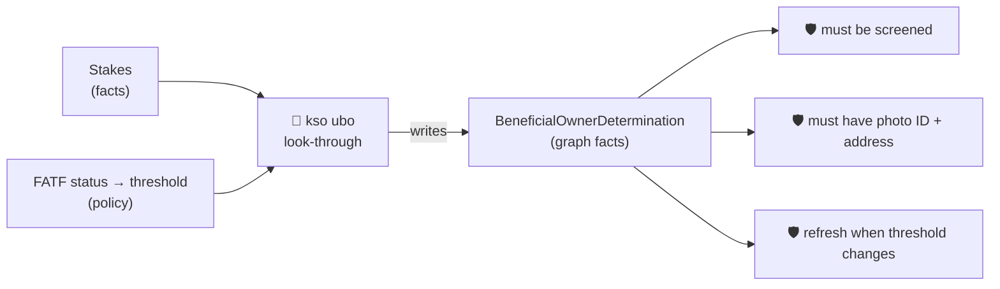

**(c) Products: a minimal sketch** *(design only)*

```turtle
kso:Product a owl:Class ;
    skos:definition "A bank product or service a customer profile can hold (e.g. trade loan, LC issuance, correspondent account)."@en .

kso:holdsProduct   a owl:ObjectProperty ; rdfs:domain kso:CustomerProfile ; rdfs:range kso:Product .
kso:productType    a owl:ObjectProperty , owl:FunctionalProperty ; rdfs:domain kso:Product ; rdfs:range skos:Concept .
kso:productRisk    a owl:ObjectProperty , owl:FunctionalProperty ; rdfs:domain kso:Product ; rdfs:range skos:Concept .   # reuse ksov:RiskTierScheme
```

This lets product risk become a `RiskFactor` (`factorSubject` → the product), and it gives 2LOD covenants something concrete to restrict: *"Conditional approval: no `ksov:CorrespondentAccount` product"* becomes checkable data instead of free text.

### 🔭 15.2 Toward a neurosymbolic compliance agent

The v0.1.0 system is the **symbolic half** of a hybrid architecture. The ontology and shapes are designed to become the **guardrail** an AI component writes through:

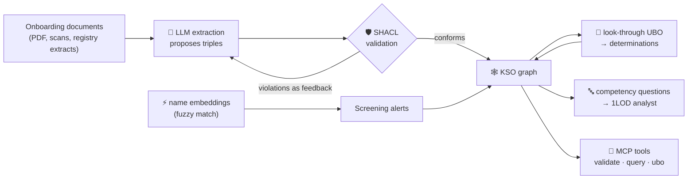

- 🔄 **Iterative refinement loop:** the model proposes and SHACL disposes. Violations go back to the model as structured feedback, so **an invalid KYC record can never enter the graph**, however confident the model is.
- ⚡ **Neural latent nodes for screening:** embedding-based name similarity (transliteration, aliases) produces `matchScore`. The graph keeps the *decision*, and the vector store only proposes candidates.
- ⚖️ **Hybrid mixing:** a combined alert score, α · neural similarity + (1 − α) · deterministic identifier agreement (LEI, IMO, registration number), where the deterministic side can *veto* but never *invent* a match.
- 🔌 **MCP interface:** expose `validate`, `query` and `ubo` as tools, so an agent's every action is an auditable call against the same rules a human analyst uses.
- 🔭 **Other open items:** FIBO / LCC alignment (`skos:closeMatch`), a correspondent example with a nested tier, published HTML docs (pyLODE → GitHub Pages).

---

## 📖 Appendix A — Term Index

Alphabetical index of every class and property, with its module. Use your browser's find (⌘F) to jump to a term's module section.

| Term | Kind | Module | Section |
|---|---|---|:--:|
| `kso:alertDisposition` | Object property | `screening` | §4.4 |
| `kso:applicant` | Object property | `trade-finance` | §4.7 |
| `kso:appliedThreshold` | Datatype property | `ownership` | §4.2 |
| `kso:assessedOn` | Datatype property | `risk` | §4.3 |
| `kso:assesses` | Object property | `risk` | §4.3 |
| `kso:beneficialOwner` | Object property | `ownership` | §4.2 |
| `kso:BeneficialOwnerDetermination` | Class | `ownership` | §4.2 |
| `kso:beneficiary` | Object property | `trade-finance` | §4.7 |
| `kso:bookedIn` | Object property | `core` | §4.1 |
| `kso:carriedBy` | Object property | `trade-finance` | §4.7 |
| `kso:carries` | Object property | `trade-finance` | §4.7 |
| `kso:Case` | Class | `governance` | §4.5 |
| `kso:caseState` | Object property | `governance` | §4.5 |
| `kso:cbddqReceivedOn` | Datatype property | `correspondent` | §4.6 |
| `kso:checker` | Object property | `governance` | §4.5 |
| `kso:concernsProfile` | Object property | `governance` | §4.5 |
| `kso:controlBasis` | Object property | `ownership` | §4.2 |
| `kso:controlledEntity` | Object property | `ownership` | §4.2 |
| `kso:controller` | Object property | `ownership` | §4.2 |
| `kso:ControlRelationship` | Class | `ownership` | §4.2 |
| `kso:correspondent` | Object property | `correspondent` | §4.6 |
| `kso:CorrespondentRelationship` | Class | `correspondent` | §4.6 |
| `kso:countryOfResidence` | Object property | `core` | §4.1 |
| `kso:covenant` | Datatype property | `governance` | §4.5 |
| `kso:CustomerProfile` | Class | `core` | §4.1 |
| `kso:destination` | Object property | `trade-finance` | §4.7 |
| `kso:determinedFor` | Object property | `ownership` | §4.2 |
| `kso:disposes` | Object property | `governance` | §4.5 |
| `kso:Disposition` | Class | `governance` | §4.5 |
| `kso:documentType` | Object property | `core` | §4.1 |
| `kso:eddRequired` | Datatype property | `risk` | §4.3 |
| `kso:effectivePercentage` | Datatype property | `ownership` | §4.2 |
| `kso:escalatedCase` | Object property | `governance` | §4.5 |
| `kso:escalatedOn` | Datatype property | `governance` | §4.5 |
| `kso:Escalation` | Class | `governance` | §4.5 |
| `kso:escalationTrigger` | Object property | `governance` | §4.5 |
| `kso:EvidenceDocument` | Class | `core` | §4.1 |
| `kso:evidences` | Object property | `core` | §4.1 |
| `kso:extendsMaster` | Object property | `core` | §4.1 |
| `kso:factorSubject` | Object property | `risk` | §4.3 |
| `kso:factorType` | Object property | `risk` | §4.3 |
| `kso:FinancialInstitution` | Class | `core` | §4.1 |
| `kso:flagState` | Object property | `trade-finance` | §4.7 |
| `kso:ForeignExtension` | Class | `core` | §4.1 |
| `kso:Goods` | Class | `trade-finance` | §4.7 |
| `kso:hasFatfStatus` | Object property | `risk` | §4.3 |
| `kso:hasRiskFactor` | Object property | `risk` | §4.3 |
| `kso:hasRiskTier` | Object property | `risk` | §4.3 |
| `kso:hasShipment` | Object property | `trade-finance` | §4.7 |
| `kso:heldIn` | Object property | `ownership` | §4.2 |
| `kso:holder` | Object property | `ownership` | §4.2 |
| `kso:hsCode` | Datatype property | `trade-finance` | §4.7 |
| `kso:imoNumber` | Datatype property | `trade-finance` | §4.7 |
| `kso:incorporatedIn` | Object property | `core` | §4.1 |
| `kso:instrument` | Object property | `trade-finance` | §4.7 |
| `kso:isDualUse` | Datatype property | `trade-finance` | §4.7 |
| `kso:isLocked` | Datatype property | `governance` | §4.5 |
| `kso:isoCountryCode` | Datatype property | `core` | §4.1 |
| `kso:issuedOn` | Datatype property | `core` | §4.1 |
| `kso:Jurisdiction` | Class | `core` | §4.1 |
| `kso:LegalEntity` | Class | `core` | §4.1 |
| `kso:legalName` | Datatype property | `core` | §4.1 |
| `kso:leiCode` | Datatype property | `core` | §4.1 |
| `kso:listAuthority` | Datatype property | `screening` | §4.4 |
| `kso:maker` | Object property | `governance` | §4.5 |
| `kso:MasterProfile` | Class | `core` | §4.1 |
| `kso:matchedList` | Object property | `screening` | §4.4 |
| `kso:matchScore` | Datatype property | `screening` | §4.4 |
| `kso:nationality` | Object property | `core` | §4.1 |
| `kso:NaturalPerson` | Class | `core` | §4.1 |
| `kso:nestedUnder` | Object property | `correspondent` | §4.6 |
| `kso:operatesIn` | Object property | `core` | §4.1 |
| `kso:origin` | Object property | `trade-finance` | §4.7 |
| `kso:outcome` | Object property | `governance` | §4.5 |
| `kso:OwnershipStake` | Class | `ownership` | §4.2 |
| `kso:owningFunction` | Object property | `governance` | §4.5 |
| `kso:Party` | Class | `core` | §4.1 |
| `kso:percentage` | Datatype property | `ownership` | §4.2 |
| `kso:permitsNestedAccess` | Datatype property | `correspondent` | §4.6 |
| `kso:primaryRegulator` | Datatype property | `core` | §4.1 |
| `kso:profileOf` | Object property | `core` | §4.1 |
| `kso:raisedBy` | Object property | `screening` | §4.4 |
| `kso:registrationNumber` | Datatype property | `core` | §4.1 |
| `kso:requiresDocument` | Object property | `core` | §4.1 |
| `kso:respondent` | Object property | `correspondent` | §4.6 |
| `kso:RiskAssessment` | Class | `risk` | §4.3 |
| `kso:RiskFactor` | Class | `risk` | §4.3 |
| `kso:riskRating` | Object property | `risk` | §4.3 |
| `kso:screenedAgainst` | Object property | `screening` | §4.4 |
| `kso:screenedAt` | Datatype property | `screening` | §4.4 |
| `kso:screenedParty` | Object property | `screening` | §4.4 |
| `kso:ScreeningAlert` | Class | `screening` | §4.4 |
| `kso:ScreeningEvent` | Class | `screening` | §4.4 |
| `kso:Shipment` | Class | `trade-finance` | §4.7 |
| `kso:TradeTransaction` | Class | `trade-finance` | §4.7 |
| `kso:transshipmentVia` | Object property | `trade-finance` | §4.7 |
| `kso:triggersEdd` | Datatype property | `risk` | §4.3 |
| `kso:uboThresholdPercent` | Datatype property | `risk` | §4.3 |
| `kso:Vessel` | Class | `trade-finance` | §4.7 |
| `kso:WatchList` | Class | `screening` | §4.4 |

## 📖 Appendix B — Glossary

| Term | Meaning |
|---|---|
| **1LOD / 2LOD / 3LOD** | First, second and third lines of defence: Operations (execute), Compliance (decide and assure), Regulators (set rules and examine) |
| **BSA** | US Bank Secrecy Act, the statutory basis for US AML programmes |
| **CBDDQ** | Wolfsberg Group Correspondent Banking Due Diligence Questionnaire |
| **CDD / EDD** | Customer Due Diligence / Enhanced Due Diligence (for higher-risk customers) |
| **FATF** | Financial Action Task Force. Its "grey list" is jurisdictions under increased monitoring; its "black list" is jurisdictions subject to a call for action |
| **HS code** | Harmonized System tariff classification of goods (6+ digits) |
| **IMO number** | International Maritime Organization ship identifier (`IMO` + 7 digits) |
| **LEI** | Legal Entity Identifier, ISO 17442 (20 characters) |
| **Maker / Checker** | Dual control: one person prepares, a different person approves |
| **OWL** | Web Ontology Language: states what terms mean (open world) |
| **RDF / Turtle** | The triple data model / its human-readable text syntax |
| **Reification** | Turning a relationship into a node so it can carry its own data |
| **SAR** | Suspicious Activity Report |
| **SHACL** | Shapes Constraint Language: validates RDF data (closed world) |
| **SKOS** | Simple Knowledge Organization System: code lists and thesauri |
| **SPARQL** | The query language for RDF graphs |
| **UBO** | Ultimate Beneficial Owner: a natural person who ultimately owns or controls an entity above a threshold |

## 📖 Appendix C — How the Figures Were Made

Nothing in this document is mocked up. Every table of classes, properties, jurisdictions and vocabularies was **generated from the Turtle files with `rdflib`**. Every screenshot shows **real output** from running this repository at v0.1.0 (Python 3.11, rdflib 7.6, pyshacl 0.40), rendered in a terminal-style frame.

| Figure | File | How |
|---|---|---|
| 1 | `images/07-class-model-map.png` | Mermaid (ELK layout) from the module definitions |
| 2 | `images/03-shacl-violations.png` | `kso validate` on a deliberately broken file |
| 3 | `images/06-harbourline-graph-explorer.png` | vis-network page generated from `examples/harbourline-commodities.ttl`, screenshotted headless |
| 4–5 | `images/04-cq01-cq03.png`, `images/05-cq04-cq05.png` | `kso query cq01 … cq05` |
| 6 | `images/02-validate-and-ubo.png` | `kso validate`, `kso ubo ex:Harbourline` |
| 7 | `images/01-pytest-27-passed.png` | `pytest -v` |

---

*Independent portfolio project. Not affiliated with, endorsed by, or derived from the internal materials of any financial institution. All example entities and people are fictional. Nothing here is legal or compliance advice.*
