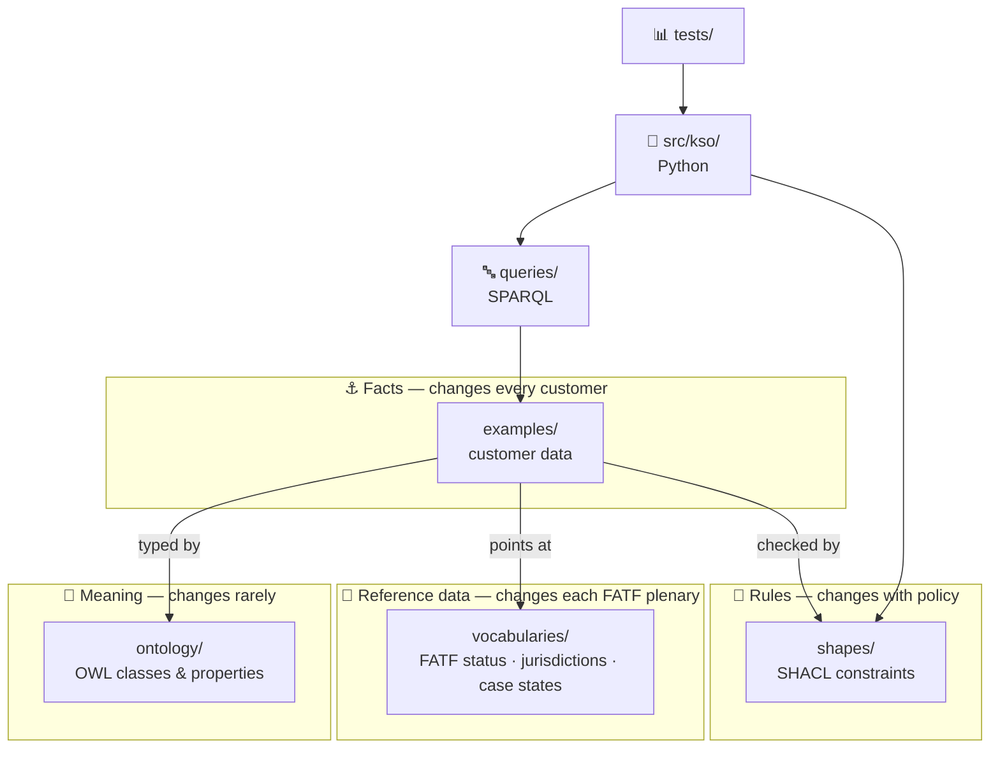
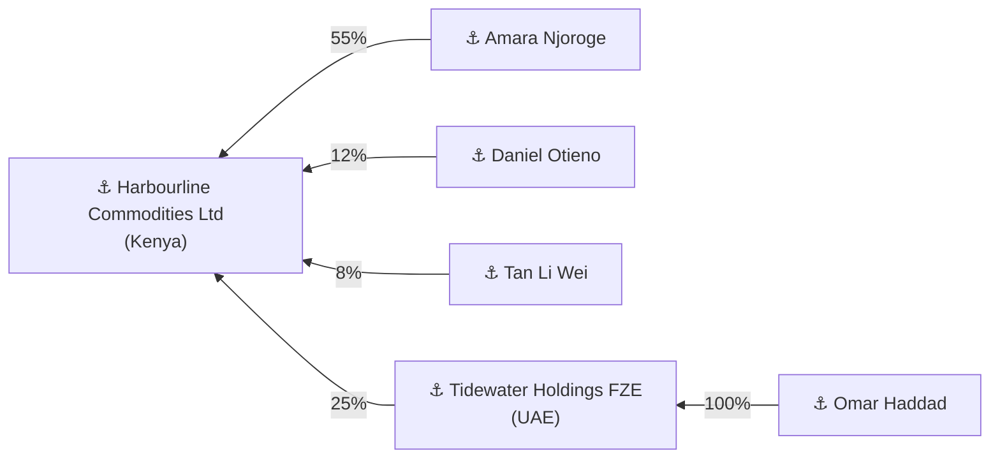
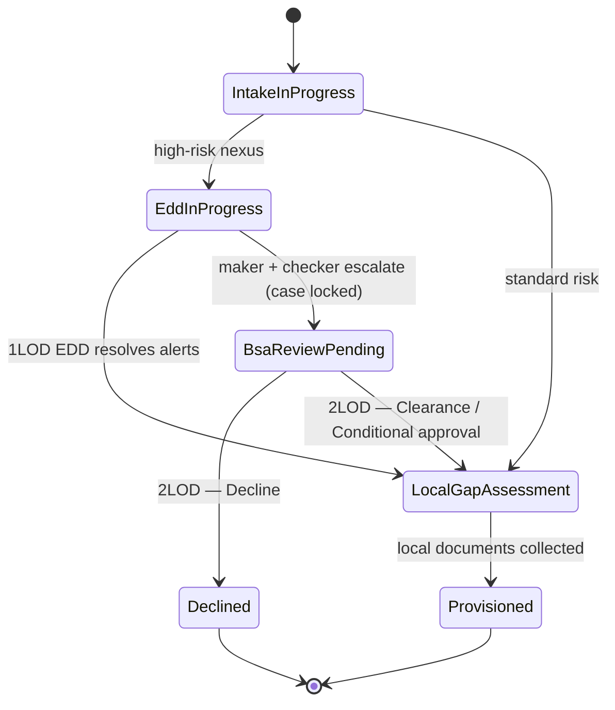
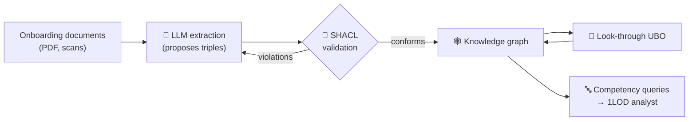

# 📑 KSO Repository Guide
**A walkthrough of the KYC & Sanctions Ontology: what each part is, why it exists, and how the pieces fit together**

---

## 📖 How to Read This Guide

Every section header carries an emoji from the **Master Technical Emoji Index**, so you can tell which *layer* of the system you're reading about at a glance.

| Emoji | Index category | Where it appears in this repo |
|:---:|---|---|
| 🧩 | Taxonomies & Classifications | Repository layout, SKOS vocabularies |
| 📜 | Ontology Schemas / Syntax | `ontology/` — the OWL modules |
| ⚓ | Symbolic Nodes / Entities | The core classes (Party, Jurisdiction, Profile…) |
| 🕸️ | Knowledge Graphs / Edges | Ownership stakes and relationships |
| 📐 | Formal Logic & Axioms | `shapes/` (SHACL constraints) and `docs/adr/` (bedrock decisions) |
| 🧭 | Agent State Nodes / DAGs | The case state machine and escalation flow |
| 🔤 | Syntax & Serialization | `queries/` — SPARQL competency questions |
| 🌉 | Symbolic–Neural Translators | `src/kso/` — the code that does what the graph can't |
| 📊 | Empirical Benchmarks | `tests/` and CI |
| 💻 | Hardware / Local Runner Setups | Running it on your machine |
| ⚠️ | Edge Cases & Failure Modes | Known limitations |
| 🔭 | Future Horizons | Roadmap, including the agentic layer |

> **Deliberately absent:** 🧬 ⚡ 🎛️ ⚖️ 🛑 (the statistical layer). KSO v0.1 is a purely **symbolic** system with no embeddings, weights or LLM calls yet. Those emojis belong to the roadmap, not to what exists today. Using them now would blur the taxonomy.

---

## 🧩 The Big Picture

KSO answers one question: **how do you represent 1LOD KYC and sanctions knowledge so that a machine can check it, query it and explain it?**

The answer is to split the knowledge into **four layers that change at different speeds**, plus tooling that works across them:



**Why separate them?** In a relational database, the schema, the lookup tables, the business rules and the data often end up tangled together. Then a FATF grey-list change forces a code release. Here, that same change is a one-line edit in `vocabularies/`, and nothing else moves.

### 🧩 File map

```text
.
├── ontology/                     📜 What things MEAN
│   ├── kso.ttl                      entry point — imports every module
│   └── modules/
│       ├── core.ttl                 parties, jurisdictions, profiles, documents
│       ├── ownership.ttl            stakes, control, UBO determinations
│       ├── risk.ttl                 FATF status, risk assessments, EDD
│       ├── screening.ttl            watch lists, screening events, alerts
│       ├── governance.ttl           cases, escalation, maker/checker, disposition
│       ├── correspondent.ttl        respondent banks, nesting tiers
│       └── trade-finance.ttl        transactions, shipments, vessels, goods
├── vocabularies/                 🧩 Controlled VALUES
│   ├── reference-codes.ttl          FATF status, risk tiers, case states, doc types
│   └── jurisdictions.ttl            the 20-jurisdiction matrix
├── shapes/                       📐 What VALID data must look like
│   └── kso-shapes.ttl
├── examples/                     ⚓ FACTS (fictional)
│   └── harbourline-commodities.ttl
├── queries/                      🔤 QUESTIONS the model must answer
│   └── cq01 … cq05 *.rq
├── src/kso/                      🌉 PYTHON tooling
│   ├── graph.py                     finds and loads the Turtle files
│   ├── ownership.py                 look-through UBO calculation
│   ├── validation.py                runs SHACL
│   └── cli.py                       the `kso` command
├── tests/                        📊 PROOF that it all works
├── docs/
│   ├── architecture/                the 1LOD / 2LOD / 3LOD operating model
│   ├── adr/                         📐 design decision records
│   └── repository-guide.md          ← you are here
└── .github/workflows/            📊 CI: runs the tests on every push
```

---

## 📜 Ontology Schemas — `ontology/`

The ontology is written in **Turtle**, a text format for RDF. Every statement is a **triple**: *subject — predicate — object*, ending in a full stop.

```turtle
kso:NaturalPerson
    a owl:Class ;                          # "NaturalPerson is a class"
    rdfs:subClassOf kso:Party ;            # "…and every NaturalPerson is a Party"
    owl:disjointWith kso:LegalEntity ;     # "…and nothing is both a person and a company"
    skos:definition "A human being. The only kind of party that can be an ultimate beneficial owner."@en .
```

How to read the syntax:

- `kso:` is a **prefix**, shorthand for `https://w3id.org/kso/ontology#`. So `kso:Party` really means `https://w3id.org/kso/ontology#Party`, a globally unique name.
- `a` is shorthand for "is of type".
- `;` means "same subject, next statement". `,` means "same subject and predicate, next object".

### Why seven modules instead of one file?

Each module answers **one question** and can be read and reviewed on its own:

| Module | The question it answers |
|---|---|
| `core` | *Who* is involved, *where* are they, and what profile does the bank hold on them? |
| `ownership` | *Who owns or controls whom*, and by how much? |
| `risk` | *How risky* is this, and does it trigger EDD? |
| `screening` | *What lists* was this party checked against, and what hit? |
| `governance` | *Who decided what*, and in what state is the case? |
| `correspondent` | *Which banks* reach us through which other banks? |
| `trade-finance` | *What goods* move *where*, on *which ship*? |

`kso.ttl` ties them together with `owl:imports`. `core` depends on nothing, and every other module depends only on `core`. That one-way dependency is intentional: you can add a new module (say, `pep.ttl`) without touching the others.

---

## ⚓ Symbolic Nodes — the core classes

These are the **rigid types**, things that are what they are regardless of context:

| Class | Meaning |
|---|---|
| `kso:Party` | Anyone who can hold rights or ownership |
| `kso:NaturalPerson` | A human (the only kind of party that can be a UBO) |
| `kso:LegalEntity` | A company, partnership, trust or foundation |
| `kso:FinancialInstitution` | A licensed bank (a kind of legal entity) |
| `kso:Jurisdiction` | A territory with its own regulator |
| `kso:MasterProfile` | The fully verified US anchor KYC record |
| `kso:ForeignExtension` | A local account abroad that *extends* the master |

### ⚓ What is deliberately *not* a class

There is **no `UBO` class** and **no `Customer` class**. This is the most important design decision in the repo ([ADR-0001](adr/0001-model-roles-and-relationships-not-types.md)):

- Nobody is "a UBO" in general. They are a UBO **of a specific entity**, **at a specific threshold**, **on a specific date**. Omar Haddad is a UBO of Harbourline at 10%, but at 30% he isn't. His shares didn't change; the policy did.
- So "UBO" is recorded as a `kso:BeneficialOwnerDetermination`: the *result of an analysis*, with the person, the entity, the percentage and the threshold applied. An examiner can see exactly why each person was, or wasn't, identified.

---

## 🕸️ Knowledge Graph Edges — relationships that carry data

A plain triple can't hold a percentage:

```turtle
ex:OmarHaddad  kso:owns  ex:Tidewater .     # …but how much? Nowhere to put "100%".
```

So ownership is **reified**, turned into a node of its own that the facts can hang off:

```turtle
ex:Stake-Haddad a kso:OwnershipStake ;
    kso:holder     ex:OmarHaddad ;
    kso:heldIn     ex:Tidewater ;
    kso:percentage 100.0 .
```

The worked example builds this graph:



The same pattern is used for `kso:ControlRelationship` (control without shares, e.g. a CEO) and `kso:CorrespondentRelationship` (bank-to-bank links, which can be `kso:nestedUnder` one another).

---

## 🧩 Taxonomies & Controlled Vocabularies — `vocabularies/`

A case state, a risk tier or a FATF status is a **value you pick from a list**, not a kind of thing. These are modelled in **SKOS** (a W3C standard for code lists and thesauri), not as OWL classes ([ADR-0004](adr/0004-reference-data-as-skos-vocabularies.md)).

**One fact, one place.** The UBO threshold is attached **once**, to the FATF status, not copied onto each of the 20 countries:

```turtle
ksov:FatfIncreasedMonitoring a skos:Concept ;
    skos:prefLabel "Increased Monitoring"@en ;
    kso:uboThresholdPercent "10"^^xsd:decimal ;
    kso:triggersEdd true .

ksoj:KE a kso:Jurisdiction ;
    skos:prefLabel "Kenya"@en ;
    kso:hasFatfStatus ksov:FatfIncreasedMonitoring .   # → threshold 10%, EDD on
```

If FATF removes Kenya from the grey list, you change **one line** (`kso:hasFatfStatus`), and every query, rule and calculation picks up the new 25% threshold automatically.

`jurisdictions.ttl` also records each regulator's **supplemental local documents** (`kso:requiresDocument`), which drive the automated gap assessment in CQ3.

---

## 📐 Formal Constraints — `shapes/`

### Open world vs closed world

This is the concept most people get wrong when they start with ontologies ([ADR-0002](adr/0002-shacl-for-validation-owl-for-meaning.md)):

| | OWL (`ontology/`) | SHACL (`shapes/`) |
|---|---|---|
| **Assumption** | Open world: a missing fact is *unknown* | Closed world: a missing fact is a *violation* |
| **Job** | Say what terms *mean* | Say what a valid record must *contain* |
| **If data is wrong** | Silently *infers* new facts, or flags the whole graph as inconsistent | Reports the exact record, the exact field, and a human message |

KYC is a closed-world problem. "We don't hold the UBO's passport" must **block onboarding**, not be treated as unknown. So OWL gives the meaning and SHACL enforces the rules.

### 📐 The rules enforced

| Rule | Operating-model source |
|---|---|
| Every legal entity is incorporated in exactly one known jurisdiction | 1LOD documentation mandates |
| Direct stakes in one entity cannot sum to more than 100% | Data integrity |
| Every jurisdiction resolves to exactly one UBO threshold | Dynamic UBO traversal |
| A foreign extension must extend a master profile **of the same party** | US Master Anchor Mandate |
| An escalation's checker cannot be its maker | Dual-control handoff |
| An escalated case must be locked | System lock |
| LEI, IMO and HS-code formats | Deterministic identifiers |

Here is the four-eyes rule. One line, `sh:disjoint`, says "no value of `checker` may equal any value of `maker`":

```turtle
sh:property [
    sh:path kso:checker ;
    sh:disjoint kso:maker ;
    sh:message "Four-eyes principle: the checker cannot be the maker." ;
] .
```

### 📐 Bedrock decisions — `docs/adr/`

Each **Architecture Decision Record** captures one choice: the context, the decision and its consequences. They exist so a reviewer (or a future you) can see *why* the repo is built this way, not just *how*.

| ADR | Decision in one line |
|---|---|
| [0001](adr/0001-model-roles-and-relationships-not-types.md) | UBO is a determination, not a class |
| [0002](adr/0002-shacl-for-validation-owl-for-meaning.md) | OWL for meaning, SHACL for validation |
| [0003](adr/0003-graph-for-facts-code-for-arithmetic.md) | The graph holds facts and policy; code does arithmetic |
| [0004](adr/0004-reference-data-as-skos-vocabularies.md) | Reference data lives in SKOS, separate from the ontology |

---

## 🧭 Case State Machine — governance

`governance.ttl` encodes the 1LOD → 2LOD escalation protocol from the [operating model](architecture/lines-of-defence-operating-model.md). Each case sits in exactly one state (`kso:caseState` is functional):



The escalation itself is a node (`kso:Escalation`) carrying the trigger, the **maker** (1LOD EDD analyst), the **checker** (1LOD Ops manager) and a timestamp. The 2LOD answer is another node (`kso:Disposition`) with an outcome and any covenants.

> Today the *states* are modelled and the *lock* is enforced, but the *transitions* (which state may follow which) are not yet validated. That is on the roadmap.

---

## 🔤 Competency Questions — `queries/`

An ontology is only as good as the questions it can answer. Each `.rq` file is a real 1LOD question written in **SPARQL**, the query language for RDF graphs. Think of it as SQL whose `WHERE` clause is a pattern of triples to match.

| ID | Question | Answer on the example |
|---|---|---|
| CQ1 | Which natural persons *directly* hold ≥ the applicable UBO threshold? | Njoroge 55%, Otieno 12% (Kenya → 10%); Haddad 100% of Tidewater (UAE → 25%) |
| CQ2 | Which profiles need EDD, and why? | Harbourline: Kenya nexus, Vietnam nexus, and the risk assessment |
| CQ3 | Which local documents are still missing for each foreign extension? | Singapore: *Local Resident Director Verification* |
| CQ4 | Which cases are locked awaiting 2LOD? | Case-0001, suspected true match, Rivera → Okafor |
| CQ5 | Which trade deals touch an EDD jurisdiction or carry dual-use goods? | LC-0001 via Kenya and Vietnam |

CQ3 shows the **"required minus collected"** pattern that powers the automated RFI:

```sparql
?j kso:requiresDocument ?docType .          # what the regulator requires…
FILTER NOT EXISTS {
    ?doc kso:evidences ?extension ;         # …minus what 1LOD already holds
         kso:documentType ?docType .
}
```

---

## 🌉 The Symbolic–Procedural Bridge — `src/kso/`

### Why there is Python at all

CQ1 only finds **direct** owners. Omar Haddad owns Harbourline **indirectly**: 100% of Tidewater × Tidewater's 25% of Harbourline = **25%**.

SPARQL can *follow* a chain of any length, but it **cannot multiply numbers along it**. So a small Python function does the arithmetic, while the **threshold it compares against is still read from the graph** ([ADR-0003](adr/0003-graph-for-facts-code-for-arithmetic.md)). The graph remains the single source of truth for policy.

This is the neurosymbolic seam in miniature: the symbolic layer holds meaning and rules, and procedural code does what logic can't. When an LLM arrives, it sits on this same seam.

### 🌉 The four modules

| File | Job |
|---|---|
| `graph.py` | Finds every `.ttl` file and loads it into an `rdflib.Graph` (an in-memory triple store) |
| `ownership.py` | Look-through ownership: multiply down each chain, sum across chains |
| `validation.py` | Runs SHACL via `pyshacl` and returns *conforms: yes/no* plus a report |
| `cli.py` | The `kso` command: `validate`, `query`, `ubo` |

### 🌉 Reading `ownership.py`, step by step

The heart of it is a function that **calls itself** (recursion). Here is a simplified version (the real one is in `src/kso/ownership.py`), traced through the Harbourline example:

```python
def walk(current, share, visited):
    for holder, percent in direct_stakes(graph, current):
        holder_share = share * percent / HUNDRED
        if holder is a NaturalPerson:
            totals[holder] += holder_share           # a human: record it, stop here
        elif holder not in visited:
            walk(holder, holder_share, visited | {holder})   # a company: look through it
```

1. Start at **Harbourline** with `share = 100`.
2. Its first stake is Njoroge at 55%. `100 × 55 / 100 = 55`. Njoroge is a person, so record **55**.
3. Otieno 12% → record **12**. Tan 8% → record **8**.
4. Tidewater 25% → `100 × 25 / 100 = 25`. Tidewater is a *company*, so **call `walk` again** starting at Tidewater with `share = 25`.
5. Inside Tidewater: Haddad 100% → `25 × 100 / 100 = 25`. He's a person, so record **25**.
6. Finally, keep everyone whose total is ≥ the threshold read from the graph (10%): **Njoroge, Haddad, Otieno**. Tan (8%) falls below.

The `visited` set is a **safety guard**: if Company A owns B and B owns A (circular ownership, a real layering technique), the walk refuses to revisit a company, so it can't loop forever. There's a test for exactly that.

Two Python habits worth noticing:

- **`Decimal`, not `float`.** `0.1 + 0.2` in floating point is `0.30000000000000004`. For regulatory percentages, `Decimal` gives exact arithmetic.
- **`@dataclass(frozen=True)`** for `BeneficialOwner`. It's a small, named, *read-only* record, which is clearer than passing around a loose tuple like `(uri, "Omar", 25)`.

---

## 📊 Empirical Benchmarks — `tests/` and CI

**27 tests**, run by `pytest`, prove four things:

| Test group | What it proves |
|---|---|
| Parsing (12 tests, one per file) | Every `.ttl` file is valid Turtle |
| SHACL policy (5 tests) | The example conforms, **and** each key rule *rejects* a deliberately broken record (maker = checker, unlocked escalation, stakes > 100%, orphan foreign extension) |
| Ownership (5 tests) | Indirect stakes multiply correctly; Kenya compresses to 10%; a 25% rule would miss Otieno; circular ownership terminates |
| Competency queries (5 tests) | CQ1–CQ5 return exactly the expected answers |

Testing that bad data **fails** matters as much as testing that good data passes. A rule that never fires is indistinguishable from a rule that doesn't exist.

`.github/workflows/validate.yml` runs the whole suite on **Python 3.10 and 3.12** every time you push to GitHub. A reviewer sees a green badge instead of taking your word for it.

---

## 💻 Running It Locally

```bash
python3 -m venv .venv && source .venv/bin/activate   # an isolated Python for this project
pip install -e ".[dev]"                              # install kso + pytest

pytest                        # run all 27 tests
kso validate                  # SHACL-check the example
kso ubo ex:Harbourline        # look-through UBO report
kso query cq03                # run any competency question
```

- `venv` creates a private Python environment, so this project's libraries never clash with anything else on your machine.
- `-e` means *editable*: changes you make in `src/kso/` take effect immediately, with no reinstall.

---

## ⚠️ Edge Cases & Known Limitations

| Limitation | Why it's acceptable for v0.1 / what fixes it |
|---|---|
| The UBO threshold comes only from the **incorporation** jurisdiction | The operating model says *any* FATF nexus compresses it. Next step: take the strictest threshold across incorporation, operations and owners' nationalities |
| **FATF statuses are point-in-time** | Transcribed from the operating-model matrix; must be re-verified each FATF plenary (Feb / Jun / Oct) |
| Case **state transitions** are not validated | States and the lock are enforced; transition rules are on the roadmap |
| UBO results are **computed, not stored** | Roadmap: write `BeneficialOwnerDetermination` nodes back into the graph |
| `w3id.org` **IRIs are not yet registered** | They're stable names, but don't resolve in a browser until the redirect is registered |
| All example data is **fictional** | By design. Real customer data must never enter this repo (`.gitignore` blocks `*.local.ttl` and `scratch/`) |

---

## 🔭 Future Horizons

The v0.1 system is fully symbolic. The roadmap moves it toward a **neurosymbolic** architecture, where the ontology becomes the guardrail for an agent:



- 🔄 **Iterative refinement loop:** the LLM proposes, SHACL verifies, violations go back as feedback. The model can never write an invalid KYC record into the graph.
- 🔌 **MCP tool interface:** expose `validate`, `query` and `ubo` as tools an agent can call.
- 🔭 **Other open items:** FIBO alignment, a correspondent-banking example with a nested tier, PEP modelling, and published HTML documentation.

---

*Independent portfolio project. Not affiliated with any financial institution. All example entities and people are fictional.*
